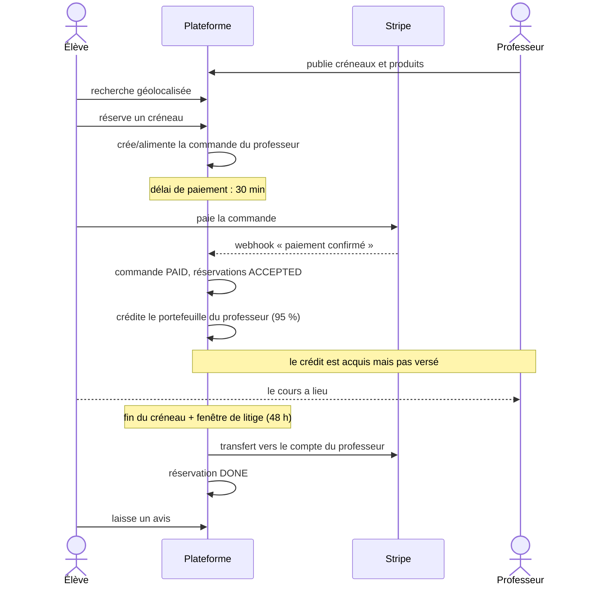
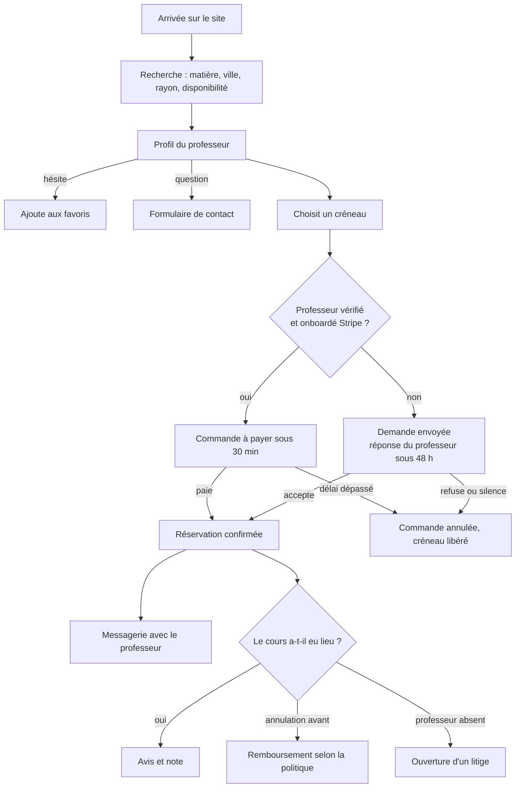
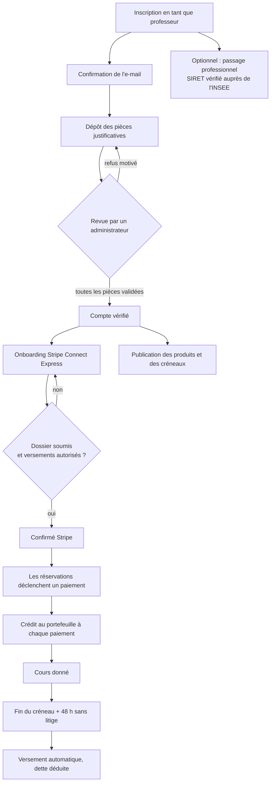
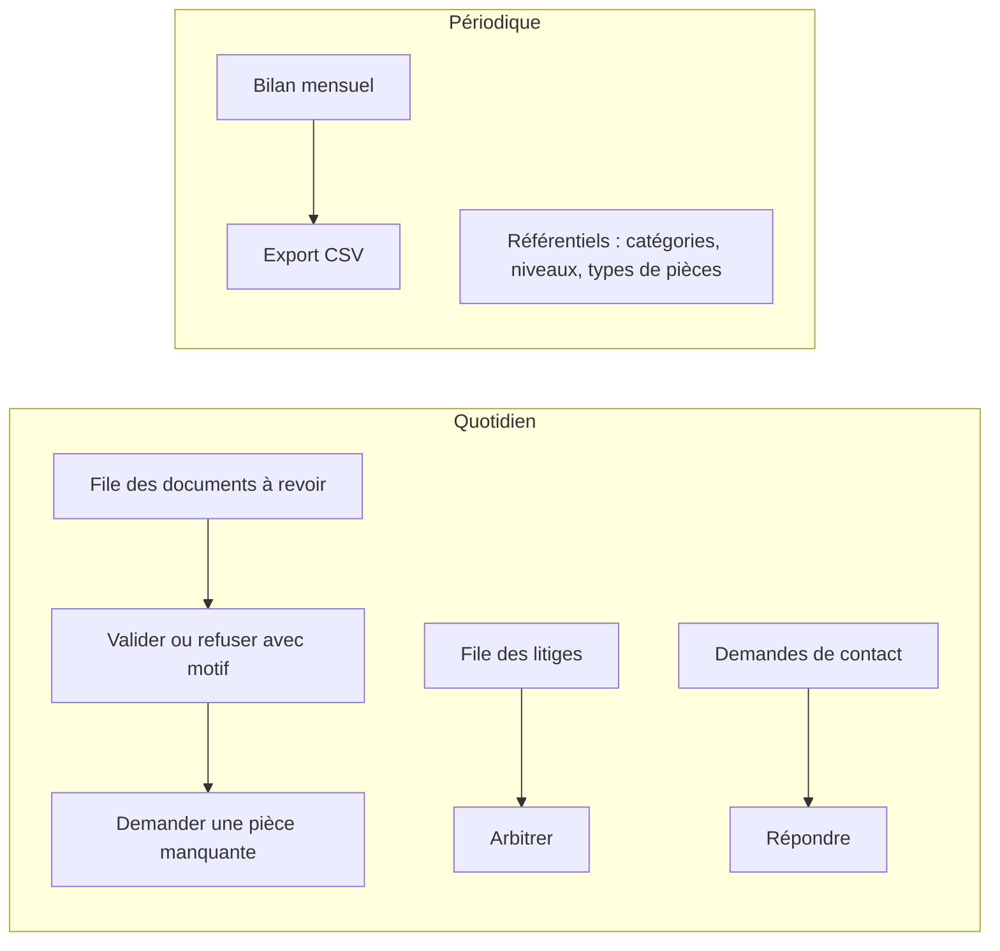
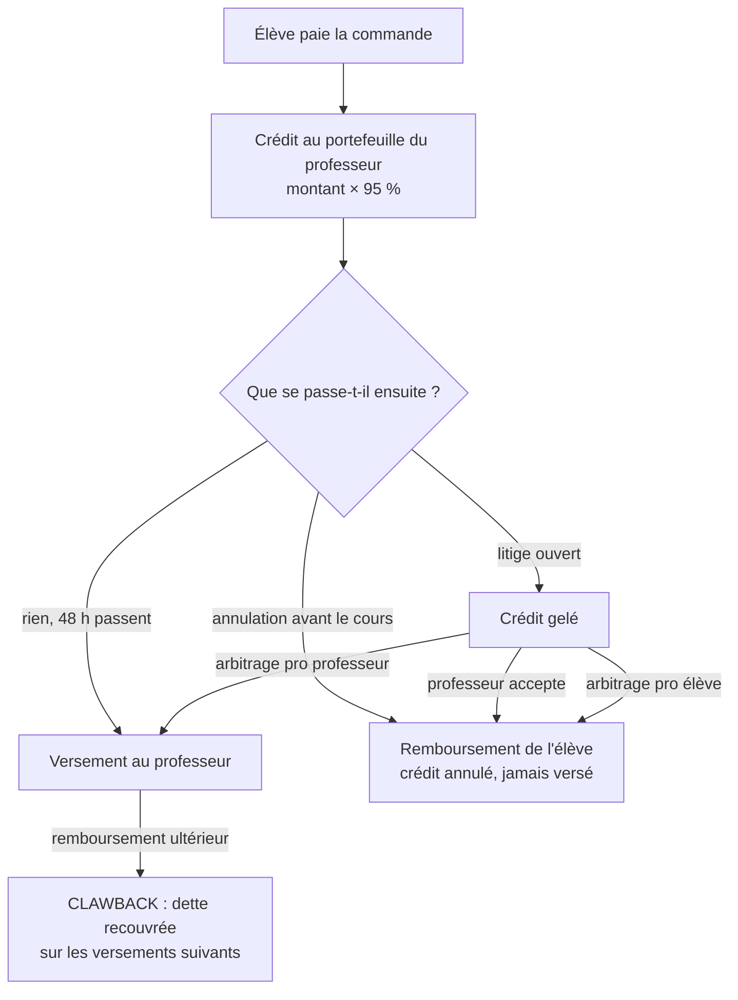

# Parcours utilisateurs

> Statut : **Stable** — vue d'ensemble bout-en-bout. Le détail est dans les
> [user stories](../10-user-stories/).

## 1. Le parcours nominal, des deux côtés

## 2. Élève — de la recherche à l'avis

Points de friction à surveiller : le **délai de 30 minutes** (tout abandon du tunnel libère
le créneau) et le **flux sans paiement**, qui allonge la boucle à 48 heures.

## 3. Professeur — de l'inscription au premier versement

**Le sas d'entrée est double** et c'est le point le plus coûteux du parcours : un professeur
vérifié mais non onboardé accumule un solde qu'il ne touche pas ; un professeur onboardé
mais non vérifié reste en flux sans paiement.

## 4. Administrateur — la boucle d'exploitation

L'objectif de conception est que **99 % des cas ne remontent jamais** à cet écran : les
versements partent tout seuls, les litiges se règlent en majorité par l'acceptation du
professeur.

## 5. Les trois chemins de sortie de l'argent

C'est le schéma à garder en tête ; le détail est dans
[flux d'argent](../20-specs-fonctionnelles/04-flux-argent.md).

**L'asymétrie est voulue :** l'inaction mène au versement, jamais au blocage.
