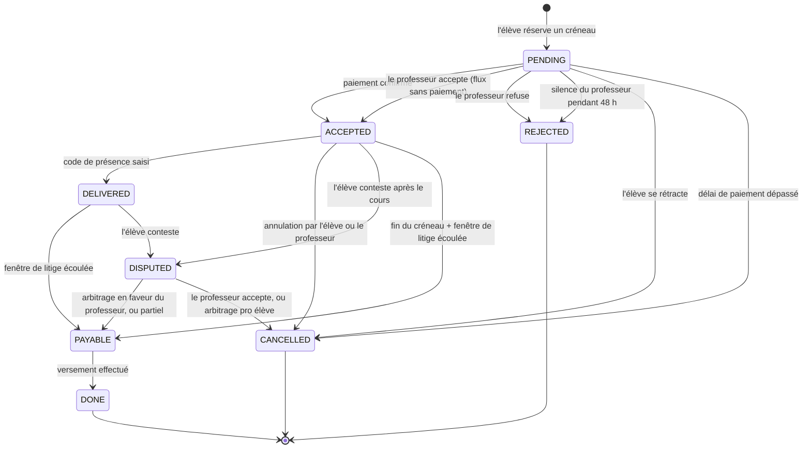
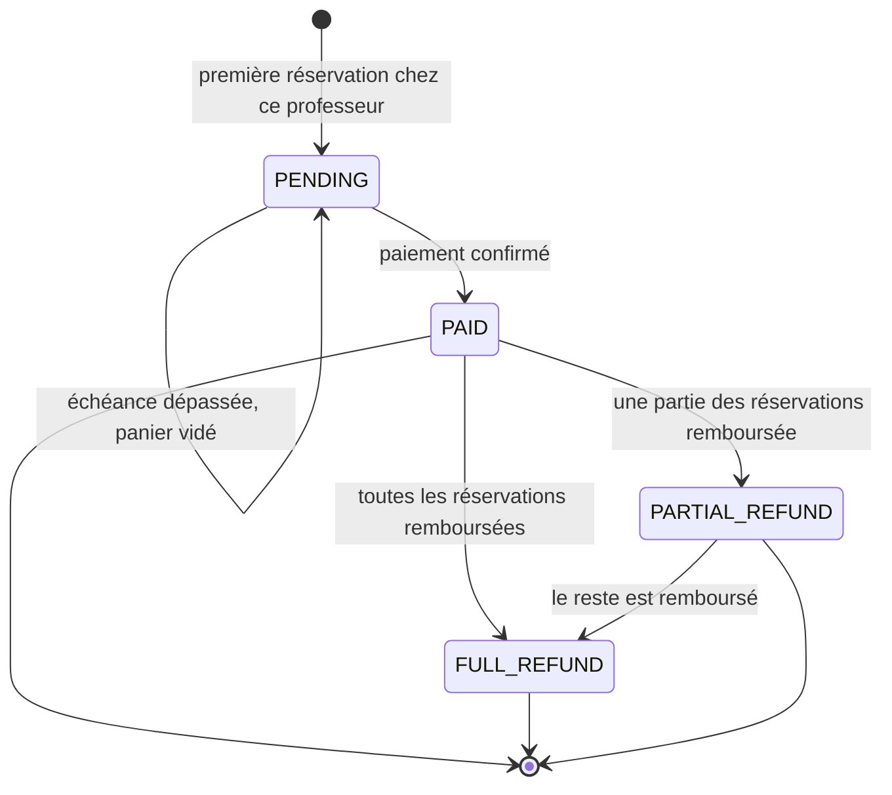
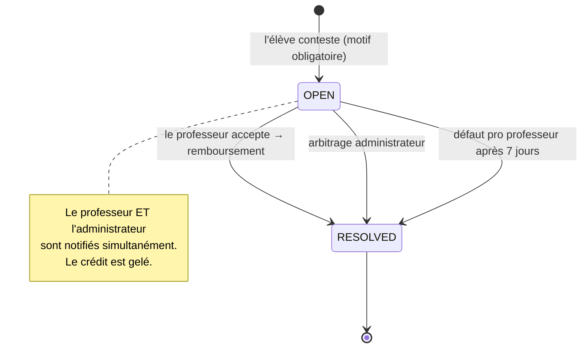
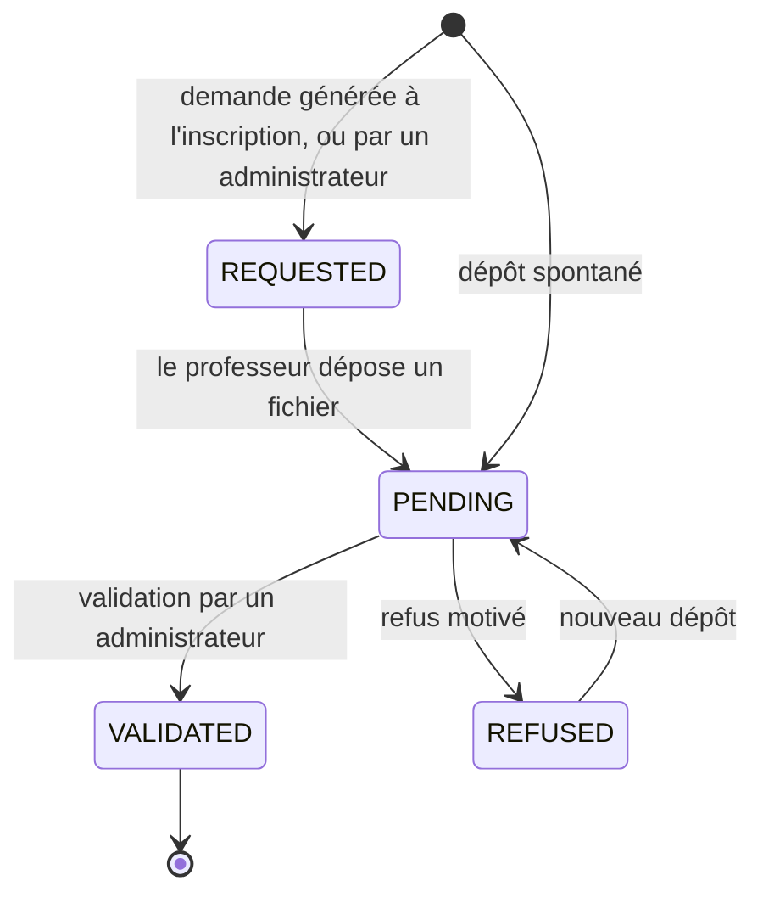
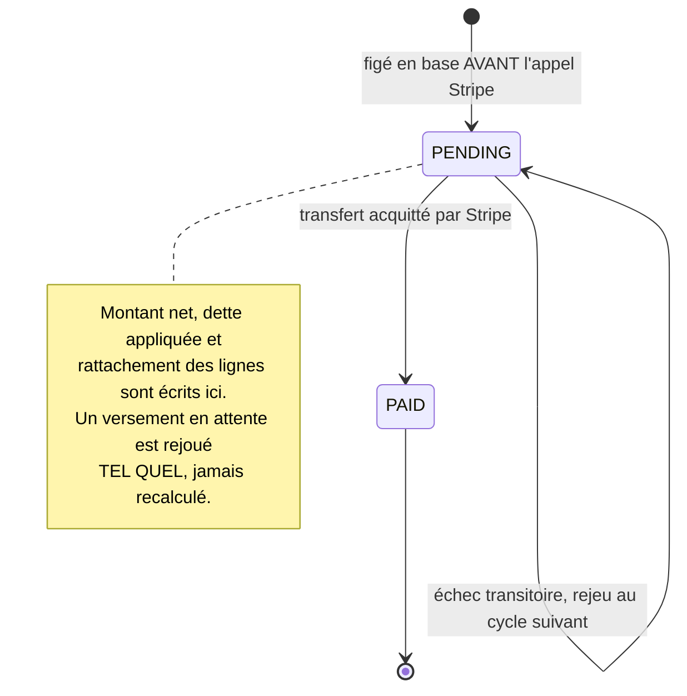
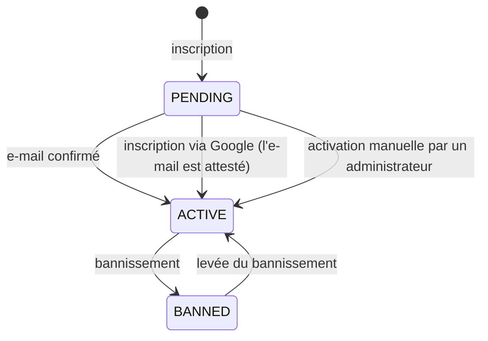

# Machines à états

> Statut : **Stable** — toute transition de réservation passe par la voie officielle décrite
> en [invariant I11](01-regles-metier.md#i11--un-statut-de-réservation-ne-change-que-par-la-voie-officielle),
> qui écrit en même temps le nouvel état et sa ligne d'historique.

## 1. Réservation

L'état central du domaine : c'est lui qui détermine si l'argent peut sortir.

### Sémantique des états

| État | Signification | Effet sur l'argent |
|---|---|---|
| `PENDING` | Réservée, non confirmée. Bloque le créneau. | Aucun mouvement. |
| `ACCEPTED` | Payée (ou acceptée par le professeur en flux sans paiement). | Le portefeuille du professeur est crédité, mais le crédit n'est pas versable. |
| `REJECTED` | Refusée par le professeur, ou jamais répondue. | Aucun mouvement ; le créneau est libéré. |
| `CANCELLED` | Annulée ou remboursée. | Le crédit du professeur est annulé ; l'élève est remboursé selon la politique. |
| `DELIVERED` | Réalisation confirmée tôt par code de présence. | Aucun effet direct ; c'est une preuve et un raccourci. |
| `PAYABLE` | Créneau terminé, fenêtre de litige écoulée, aucun litige. | Le crédit devient éligible au versement. |
| `DISPUTED` | Contestée par l'élève. | **Gèle** le crédit : exclu du versement jusqu'à résolution. |
| `DONE` | Cycle terminé, professeur versé. | Ouvre le droit de déposer un avis. |

### Transitions interdites

- Aucun retour depuis `DONE`, `CANCELLED` ou `REJECTED` : ce sont des états terminaux.
- `DISPUTED → DONE` : un litige gagné **ne termine pas** la réservation, il la rend versable.
  `DONE` signifie « professeur versé », et seule la tâche de versement peut l'affirmer. Y aller
  directement sortirait la réservation de sa sélection : le gel aurait simplement changé de nom.
- `PENDING → DISPUTED` : on ne conteste pas un cours qui n'a pas été payé.
- `PENDING → PAYABLE` : rien à verser.
- `ACCEPTED → DISPUTED` **avant** la fin du créneau : avant le cours, c'est une annulation,
  pas un litige.
- `→ DISPUTED` après l'échéance de contestation : trop tard, le professeur est versé.

### Les deux chemins vers `PAYABLE`

C'est le cœur du modèle de confiance : `PAYABLE` est atteint **par le temps**, pas par une
confirmation. Le code de présence ne fait que raccourcir le trajet ; son absence ne bloque
jamais le versement. Voir [E10](../10-user-stories/E10-preuve-de-realisation.md).

### État dans le code

Toutes les transitions passent par `TransitionStatusTo`
([`ReservationStatusExtensions`](../../RestaurantHandler/Utilities/ReservationStatusExtensions.cs)), qui
refuse depuis le lot 4 toute transition hors du graphe ci-dessus
([`ReservationStateMachine`](../../RestaurantHandler/Domain/Policies/ReservationStateMachine.cs), exception
`InvalidReservationTransitionException`). L'arête `ACCEPTED → DONE` n'y est admise que pour une
commande **sans paiement** : une réservation payée n'atteint `DONE` que par `PAYABLE`.

| Transition cible | Dans le code | Écart |
|---|---|---|
| `PENDING → ACCEPTED` (paiement) | `PaymentService`, webhook `checkout.session.completed` | — |
| `PENDING → ACCEPTED / REJECTED` (professeur) | `ReservationService` | — |
| `PENDING → REJECTED` (professeur, ou silence 48 h) | `ReservationService`, `JobChron.ExpireStaleNoPaymentReservations` | — la ligne est conservée et détachée de sa commande |
| `PENDING → CANCELLED` (élève, ou délai de paiement) | `ReservationService`, `JobChron.CleanStalePendingOrders`, webhook `checkout.session.expired` | — la ligne est conservée et détachée de sa commande |
| `ACCEPTED → DELIVERED` | `ReservationService` (code de présence) | — |
| `ACCEPTED → CANCELLED` | `ReservationService` (annulation) | — |
| `ACCEPTED / DELIVERED → DISPUTED` | `DisputeService.OpenDisputeAsync` | — |
| `ACCEPTED / DELIVERED → PAYABLE` | `JobChron.MarkReservationsPayable`, en tête de `PayoutTeacherBalances` | — le versement ne sélectionne que `PAYABLE` |
| `DISPUTED → PAYABLE` (pro professeur, partiel) | `DisputeService.CloseDisputeAsync` | — |
| `DISPUTED → CANCELLED` (le professeur accepte) | **absente** | seul l'arbitrage administrateur existe |
| `PAYABLE → DONE` (versement) | `JobChron` | — |
| flux sans paiement → `DONE` | `JobChron.CompleteNoPaymentReservations` | — |

## 2. Commande

**Particularités :**

- Une commande en attente dont l'échéance passe n'est pas supprimée : elle est **vidée** et
  redevient disponible pour une nouvelle réservation chez le même professeur. Le compteur de
  tentatives de paiement, lui, n'est jamais remis à zéro — il alimente la clé d'idempotence.
- Une commande en flux sans paiement reste `PENDING` indéfiniment : aucun paiement n'est
  jamais créé.
- Les états de remboursement sont **dérivés** du rapport entre la somme des remboursements
  et le total de la commande.

### État dans le code

- Le vidage à échéance existe (`Order.Reset`) et ne remet pas `CheckoutAttempt` à zéro.
- Le passage en remboursement partiel ou total est calculé dans `DisputeService`,
  `ReservationCancellationService` et `StripeRefundService` (remboursement émis depuis
  Stripe), avec trois copies du même calcul.

## 3. Litige

**Issue :** professeur (gel levé, le crédit redevient versable), élève (remboursement
intégral), ou partielle (remboursement d'un montant inférieur au montant de la réservation).

**Le professeur et l'administrateur voient le litige en même temps** — pas de phase
séquentielle. L'acceptation par le professeur est la voie rapide qui vide l'essentiel des
cas sans intervention humaine côté plateforme.

**Les trois voies produisent le même règlement.** Acceptation, arbitrage et résolution par
défaut passent par le même calcul de répartition : elles ne peuvent pas annoncer trois montants
différents pour la même issue. Seul l'auteur de la ligne d'audit change, et il est **vide** pour
la résolution automatique — c'est ce qui la rend lisible comme telle. Voir
[ADR-0011](../40-decisions/ADR-0011-resolution-auto-litige.md).

Un litige n'est recevable que sur une réservation **payée** : le flux sans paiement se déroule
hors plateforme financièrement, il n'y a ni crédit à geler ni encaissement à rembourser
([ADR-0010](../40-decisions/ADR-0010-flux-sans-paiement.md)).

### État dans le code

- `OPEN → RESOLVED` par arbitrage : [`DisputeService.CloseDisputeAsync`](../../RestaurantHandler/Services/DisputeService.cs).
- Litige refusé en flux sans paiement ; un seul litige vivant par réservation (index unique
  filtré sur `Disputes.ReservationId`).
- **Absents** : acceptation par le professeur, résolution par défaut à 7 jours et relance de
  l'administration ([ADR-0011](../40-decisions/ADR-0011-resolution-auto-litige.md)).

## 4. Pièce justificative

L'état `IsVerified` du professeur est **recalculé**, jamais posé à la main : il est vrai
lorsque toutes les demandes ouvertes sont satisfaites par une pièce validée. Une demande
est fermée par archivage.

### État dans le code

Pas d'état `REQUESTED` sur la pièce elle-même : la demande est l'entité
`TeacherDocumentRequest`, et la revue suit `DocumentReviewStatusEnum` (`Pending`,
`Validated`, `Refused`). `IsVerified` est bien recalculé, par
[`TeacherVerificationHelper`](../../RestaurantHandler/Utilities/TeacherVerificationHelper.cs).

## 5. Versement

Voir les invariants [I5](01-regles-metier.md#i5--lappel-externe-dabord-la-validation-en-base-ensuite)
et [I7](01-regles-metier.md#i7--le-montant-dun-versement-est-figé-avant-lappel-stripe).

Un versement dont la dette absorbe intégralement le montant vaut 0 € et **ne déclenche
aucun appel Stripe** : c'est un règlement par compensation.

### État dans le code

Appliqué dans [`JobChron.PayoutTeacherBalances`](../../RestaurantHandler/Services/JobChron.cs), qui commence par
`RetryPendingPayouts`.

## 6. Compte utilisateur

Un compte banni ne peut ni se connecter ni être connecté via Google : le contrôle est fait
**avant** toute écriture.

### État dans le code

**Non tenu.** Seule la connexion Google refuse un compte banni
([`SignInService.GoogleLogin`](../../RestaurantHandler/Services/Auth/SignInService.cs)). La connexion par mot de passe
(`AuthService.Login`) et le renouvellement de session (`UpdateRefreshToken`) ne vérifient
**ni** le bannissement **ni** la confirmation de l'e-mail : un compte banni ou jamais activé
obtient une session. Voir la [dette technique](../50-backlog/03-dette-technique.md).
