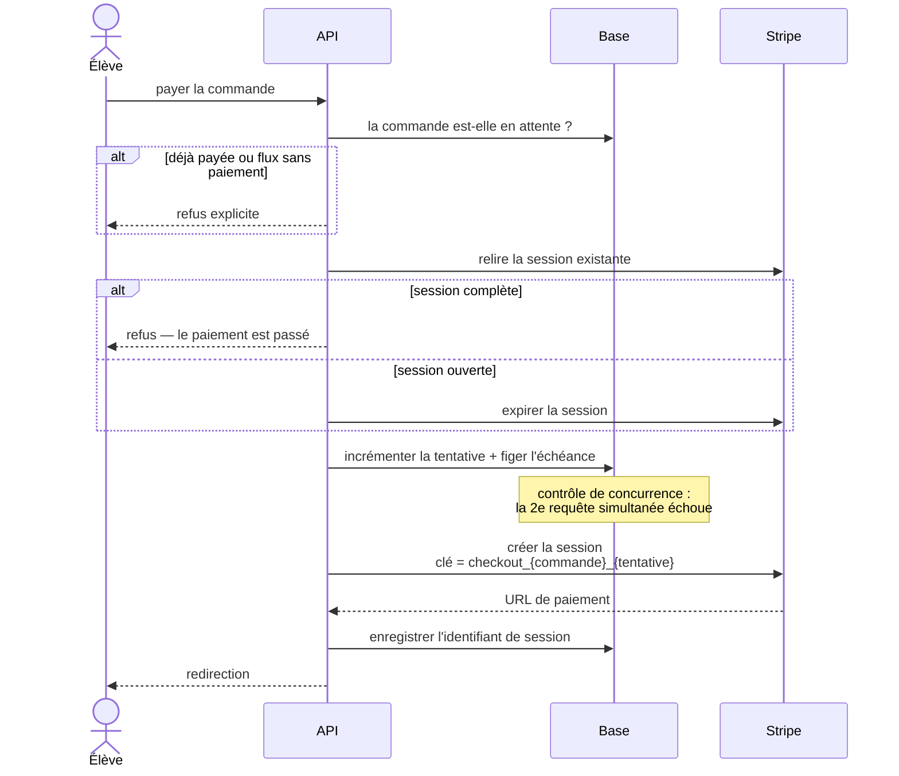
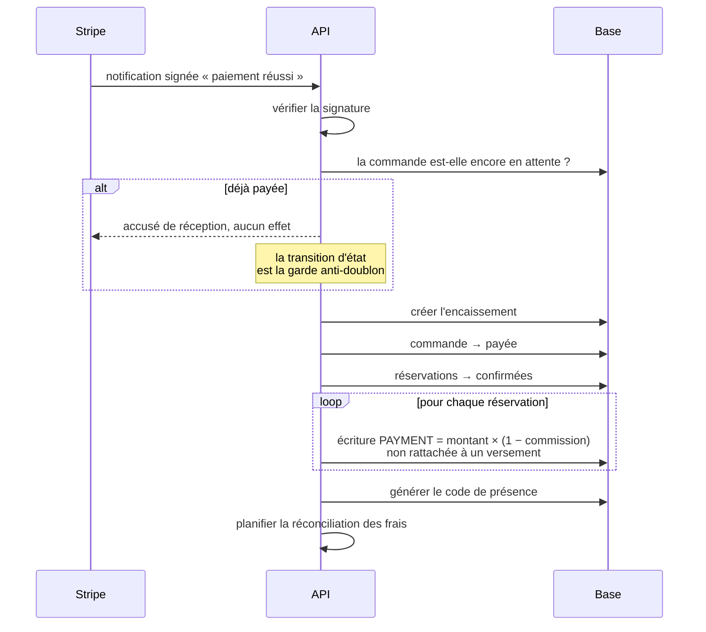
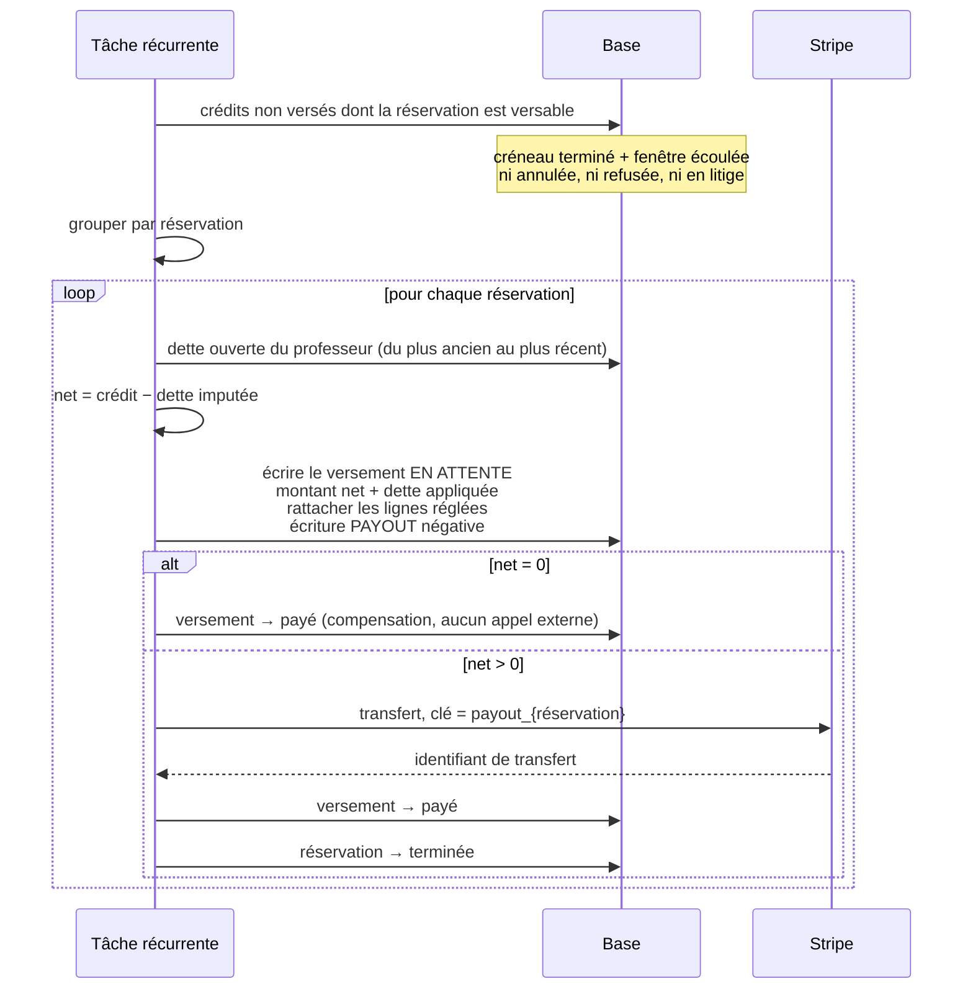
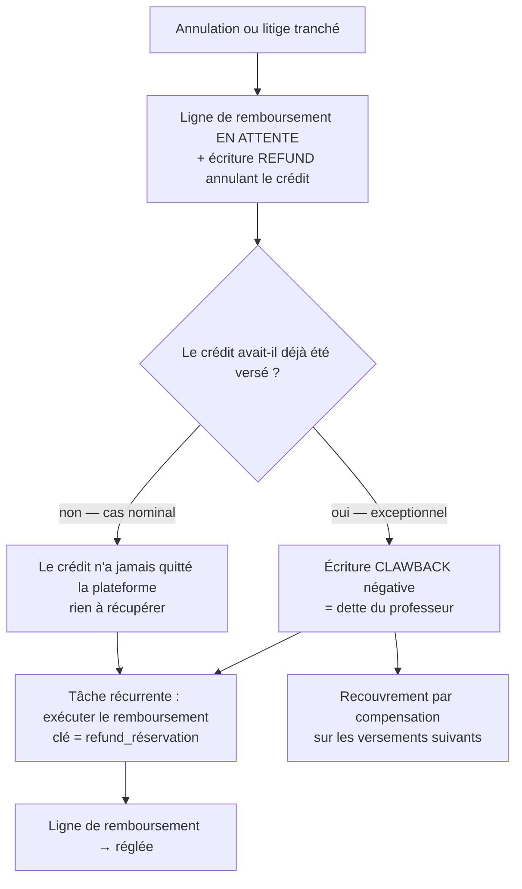
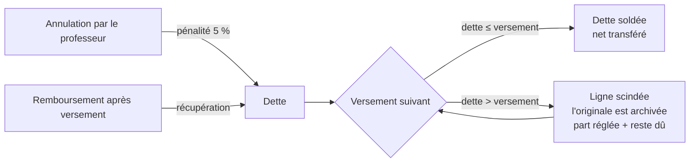

# Flux d'argent

> Statut : **Stable** · Invariants : [I3 à I10](01-regles-metier.md#2-invariants--les-règles-qui-ne-doivent-jamais-être-violées)

## Le modèle

**Encaissement séparé, reversement différé.** L'élève paie *la plateforme* ; la plateforme
reverse *chaque professeur* plus tard. L'élève ne paie jamais directement le professeur.

Une commande étant mono-professeur, un encaissement concerne un seul vendeur. Un élève qui
réserve chez plusieurs professeurs cumule plusieurs commandes et plusieurs paiements.

| Concept | Entité | Côté |
|---|---|---|
| Panier mono-professeur | `Order` | acheteur |
| Professeur de la commande | `Order.TeacherId` | lien |
| Encaissement (1:1 avec la commande) | `Payment` | acheteur |
| Réservation | `Reservation` / `Slot` | lien |
| Écriture au grand livre | `TeacherWalletTransaction` | vendeur |
| Versement sortant | `TeacherPayout` | vendeur |
| Remboursement | `Refund` | acheteur |

Le professeur d'une réservation vient du **créneau**. `Order.TeacherId` dénormalise cette
information pour garantir l'invariant « une commande = un professeur » et permettre de
retrouver le panier en attente d'un couple élève-professeur en une lecture.

---

## 1. Encaissement

**Pourquoi figer avant d'appeler.** Stripe refuse une même clé d'idempotence accompagnée de
paramètres différents. Une échéance recalculée à chaque essai casserait donc le rejeu. Elle
est arrondie à la minute supérieure : valeur reproductible **et** minimum de 30 minutes
garanti.

## 2. Confirmation et crédit

Le crédit est calculé à partir du **montant et du taux figés sur la réservation**, jamais
des prix courants.

## 3. Versement

**Trois choix structurants :**

- **Un transfert par réservation**, pas par lot : rend la clé d'idempotence stable et isole
  les échecs.
- **Le versement est figé en base avant l'appel.** Depuis que le montant dépend de la dette,
  un montant recalculé au cycle suivant enverrait la même clé avec des paramètres
  différents — que Stripe rejette. Un versement resté en attente est **rejoué tel quel**.
- **Un versement entièrement absorbé par la dette ne produit aucun appel externe.** C'est un
  règlement par compensation, pas un transfert de zéro euro.

## 4. Remboursement

Le cas « déjà versé » est **exceptionnel par construction** : la fenêtre de contestation
étant bornée par le délai de versement, un litige ne peut pas survenir après un versement.
Il ne reste que les remboursements décidés hors parcours applicatif.

## 5. La dette

**Ce qui fait la dette, c'est le type, pas le signe.** Une écriture de remboursement est
négative mais toujours adossée au crédit de la même réservation : les deux s'annulent, rien
n'est dû. Seules les écritures de pénalité et de récupération sont des créances réelles.

**La scission plutôt que la mutation.** Quand une dette dépasse le versement, on n'écrase
pas le montant de la ligne : elle est archivée et remplacée par deux lignes qui somment à
l'identique. La somme des lignes vivantes reste la dette infligée — comptabilité
d'engagement — et la somme des lignes non réglées reste ce qui est encore dû. **Toute
requête doit donc exclure les lignes archivées.**

## 6. Où va chaque euro

Pour une réservation de 100 € payée, cours donné, sans incident :

| Étape | Élève | Plateforme | Professeur |
|---|---|---|---|
| Paiement | −100,00 | +100,00 | — |
| Frais du prestataire | — | −2,20 *(indicatif)* | — |
| Crédit au portefeuille | — | — | +95,00 *(non versé)* |
| Versement | — | −95,00 | +95,00 *(reçu)* |
| **Solde final** | **−100,00** | **+2,80** | **+95,00** |

Les frais réels ne sont connus qu'après règlement chez le prestataire ; jusque-là le gain de
la plateforme est affiché comme **provisoire**.

## 7. Ce qui est intentionnellement absent

- **Aucun déclenchement manuel** d'un versement ou d'un remboursement, par personne.
- **Aucune tâche programmée par réservation.** Tout passe par des tâches récurrentes qui
  interrogent la base : un redémarrage ou un déploiement ne peut jamais faire perdre un
  mouvement d'argent.
- **Aucun renvoi de transfert** depuis le compte d'un professeur : la compensation suffit.
  Voir [ADR-0006](../40-decisions/ADR-0006-dette-prof-compensation.md).

## 8. État dans le code

| Étape | Code | État |
|---|---|---|
| Encaissement | `CheckoutService.CreateCheckoutAsync` ([`CheckoutService`](../../RestaurantHandler/Services/Payments/CheckoutService.cs)) | Conforme. Le point d'accès est toutefois **anonyme** et ne vérifie pas la propriété de la commande. |
| Confirmation et crédit | webhook `checkout.session.completed`, même service | Conforme, code de présence compris (généré ici depuis le lot 4). |
| Réconciliation des frais | `PaymentService.BackfillStripeFeesAsync`, planifiée par `BackgroundJob.Schedule` | Conforme. |
| Versement | `JobChron.PayoutTeacherBalances` ([`JobChron`](../../RestaurantHandler/Services/JobChron.cs)) | Conforme. Ne sélectionne que les réservations `PAYABLE` (voir [machines à états](02-machines-etats.md#état-dans-le-code)). |
| Remboursement | `Refund` en attente + `JobChron.ProcessPendingRefunds` | Conforme. |
| Récupération | webhook `charge.refunded` → écriture `CLAWBACK` ([`StripeRefundService`](../../RestaurantHandler/Services/Payments/StripeRefundService.cs)) | Conforme. |
| Dette et scission | `JobChron.PayoutTeacherBalances` | Conforme. |

**Écart critique à la section 7, corrigé au lot 0.** Un déclenchement manuel existait :
`POST /Payment/connect/transfer` appelait `PaymentService.CreateTransferAsync` avec un
**compte de destination et un montant fournis par l'appelant**, sans authentification. La
route est supprimée ; `CreateTransferAsync` n'est plus appelé que par `JobChron`. Voir la
[dette technique](../50-backlog/03-dette-technique.md) (D-01).
