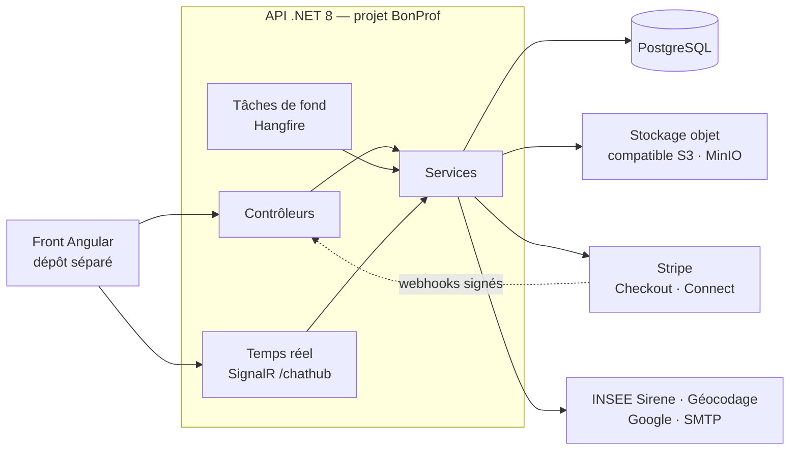

# Architecture

> Statut : **Stable** · Décisions : [ADR-0001](../40-decisions/ADR-0001-archi-backend.md),
> [ADR-0008](../40-decisions/ADR-0008-stockage-objet-unifie.md)
>
> Ce document décrit **l'existant**, puis **la cible** et l'écart entre les deux. Le chemin
> pour combler l'écart est dans la [feuille de route](../50-backlog/01-roadmap-refactoring.md).

## Vue d'ensemble



Ce qu'expose l'API à ses clients est décrit dans [clients de l'API](07-clients.md).

## Le dépôt

```
BonProfAPI/
├── BonProfAPI.sln
├── RestaurantHandler/                  le seul projet (ASP.NET Core, .NET 8)
│   ├── Controllers/          26 contrôleurs + ChatHub
│   ├── Services/             la logique métier (37 services)
│   │   └── Interfaces/       2 interfaces seulement (favoris, avis)
│   ├── Models/               entités ET représentations (DTO) mêlées, par domaine
│   ├── Contexts/             MainContext (≈ 960 lignes : configuration + alimentation)
│   ├── Migrations/           une migration de remise à zéro
│   ├── Utilities/            constantes, politiques, filtres, aides diverses
│   ├── Templates/            gabarits Razor des e-mails
│   ├── Docs/                 notes techniques ponctuelles
│   ├── Program.cs            ≈ 500 lignes : injection, authentification, pipeline, alimentation
│   └── Dockerfile
├── docs/                     ces spécifications
└── .github/workflows/        construction et publication des images
```

**Tests :** `tests/BonProf.IntegrationTests` (API + PostgreSQL éphémère), créé au lot 0 avec
les tests de sécurité. Voir [stratégie de tests](09-strategie-tests.md).

## Backend actuel

### Le découpage

Contrôleurs → services → `MainContext` (EF Core), dans un seul projet. Les services sont des
classes concrètes injectées directement ; seuls `FavoriteService` et `ReviewService` ont une
interface.

### Taille des services

Le premier indicateur de dette. Seuil : 800 lignes, tenu depuis le lot 3. Les cinq services
qui le dépassaient ont été scindés par responsabilité, chacun dans son dossier :

| Dossier | Services |
|---|---|
| [`Services/Payments/`](../../RestaurantHandler/Services/Payments) | checkout, webhook de checkout, Connect et transferts, remboursements, aiguillage des webhooks ; `PaymentService` garde le rattrapage des frais Stripe, dont le nom est sérialisé par Hangfire |
| [`Services/Reservations/`](../../RestaurantHandler/Services/Reservations) | lecture, réservation et acceptation, panier, code de présence, annulation |
| [`Services/Orders/`](../../RestaurantHandler/Services/Orders) | commandes, comptabilité d'une commande, bilans mensuels et exports |
| [`Services/Users/`](../../RestaurantHandler/Services/Users) | profils, profil professeur et passage en professionnel, recherche, pièces justificatives, contact, administration des comptes |
| [`Services/Auth/`](../../RestaurantHandler/Services/Auth) | inscription, connexion et Google, mot de passe, jetons, avatar |

Les plus gros restants, à surveiller :

| Fichier | Lignes | Responsabilité |
|---|--:|---|
| [`TableStateUtilities`](../../RestaurantHandler/Utilities/TableStateUtilities.cs) | 762 | moteur de filtre dynamique |
| [`UserManagementService`](../../RestaurantHandler/Services/UserManagementService.cs) | 738 | back-office comptes et pièces |
| [`DisputeService`](../../RestaurantHandler/Services/DisputeService.cs) | 735 | litiges |
| [`JobChron`](../../RestaurantHandler/Services/JobChron.cs) | 717 | toutes les tâches récurrentes d'argent |

### Briques à préserver

Elles encodent des invariants durement acquis. Le refactoring les garde telles quelles et
les couvre de tests en premier.

| Brique | Fichier | Rôle |
|---|---|---|
| Politique d'annulation | [`CancellationPolicy`](../../RestaurantHandler/Domain/Policies/CancellationPolicy.cs) | qui paie quoi, partagée exécution et prévisualisation |
| Transitions de statut | [`ReservationStatusExtensions`](../../RestaurantHandler/Utilities/ReservationStatusExtensions.cs) | la seule voie de changement d'état, avec journal d'audit |
| Recalcul de vérification | [`TeacherVerificationHelper`](../../RestaurantHandler/Utilities/TeacherVerificationHelper.cs) | l'état vérifié n'est jamais posé à la main |
| Définition de disponibilité | [`TeacherAvailability`](../../RestaurantHandler/Domain/Policies/TeacherAvailability.cs) | une seule définition pour le filtre, le tri et le compteur |
| Moteur de filtre dynamique | [`TableStateUtilities`](../../RestaurantHandler/Utilities/TableStateUtilities.cs) | le contrat unique de pagination, tri et filtre |
| Bornes de mois | [`MonthRange`](../../RestaurantHandler/Domain/Policies/MonthRange.cs) | calcul des périodes en heure de plateforme |
| Export tabulaire | [`Csv`](../../RestaurantHandler/Utilities/Csv.cs) | format lisible par un tableur français |
| Validation SIRET | [`SiretAttribute`](../../RestaurantHandler/Utilities/SiretAttribute.cs) | clé de Luhn et exception La Poste |
| Distance géographique | [`HeoHelper`](../../RestaurantHandler/Utilities/HeoHelper.cs) | boîte englobante puis distance exacte |
| Constantes | [`HardCode`](../../RestaurantHandler/Utilities/HardCode.cs) | valeurs métier et identifiants de référentiel |

### Plateforme

| Élément | Existant | Cible |
|---|---|---|
| Cadre | ASP.NET Core **.NET 8**, nullable activé | inchangé ; montée de version indépendante du refactoring |
| Accès aux données | EF Core 8, PostgreSQL (Npgsql, `jsonb` dynamique) | inchangé |
| Identité | ASP.NET Core Identity, clés `Guid`, JWT en en-tête + jeton de renouvellement en cookie | session par cookie ([ADR-0002](../40-decisions/ADR-0002-auth-cookies-httponly.md)) |
| Tâches de fond | Hangfire, stockage PostgreSQL | inchangé ; tableau de bord protégé |
| Cache | `HybridCache` en mémoire, référentiels et géocodage seulement | Redis en second niveau au passage multi-instance ([ADR-0017](../40-decisions/ADR-0017-cache-memoire.md)) |
| Temps réel | SignalR, `/chathub` | inchangé |
| Description d'API | Swashbuckle ; JSON toujours publié, interface en développement ou démo | inchangé |
| Documents | QuestPDF (factures) | inchangé |
| Images | ImageSharp (avatars) | inchangé |
| E-mails | MailKit + RazorLight, via Hangfire | inchangé ; plus de contenu rendu dans la file |
| Stockage | AWS SDK S3 derrière `StorageService` (MinIO) | inchangé ([ADR-0008](../40-decisions/ADR-0008-stockage-objet-unifie.md)) |
| Journalisation | `ILogger` et `Console.WriteLine` mêlés | structurée, avec identifiant de corrélation |
| Erreurs | page développeur en développement, rien de normalisé ailleurs | `ProblemDetails` partout |
| Dépendances | Newtonsoft.Json référencé mais inutilisé ; chemins Windows en dur dans le `.csproj` | nettoyées |

### Le pipeline HTTP

Ordre actuel dans [`Program.cs`](../../RestaurantHandler/Program.cs) : filtre de taille (200 Mo) → fichiers
statiques → Swagger → **tableau de bord Hangfire** → routage → CORS → authentification →
autorisation → contrôleurs et hub. Le tableau de bord étant monté avant l'authentification,
il est anonyme. Voir [sécurité](04-securite.md).

## Cible

### Le découpage

**Contrôleurs → Services → EF Core, dans un seul projet** — le découpage actuel, conservé
délibérément. Ce qui change, c'est la discipline :

| Règle | Énoncé |
|---|---|
| Un contrôleur ne contient **aucune** logique | il valide l'entrée, appelle un service, met en forme la réponse |
| Un service ne connaît **ni** `HttpContext` **ni** `ClaimsPrincipal` | l'identité de l'appelant lui est passée en paramètre |
| Une entité ne sort **jamais** de l'API | tout passe par une représentation dédiée |
| Une règle métier vit à **un seul endroit** | annulation, disponibilité, transition de statut, vérification |
| Un service dépasse 800 lignes ? | il porte plusieurs responsabilités, on le scinde |

### Organisation des dossiers

Réorganisation progressive, **dossier par dossier**, sans changer d'espace de noms public
tant qu'un domaine n'est pas migré en entier. Depuis le lot 3, `Domain/` (entités et
`Policies/`), `Contracts/`, `Persistence/` (contexte, configurations, alimentation) et
`Infrastructure/Errors/` existent ; les dossiers déplacés gardent leur espace de noms
(`BonProf.Models`, `BonProf.Utilities`, `BonProf.Contexts`). `Jobs/`, `Realtime/` et
`Integrations/` restent à faire :

```
RestaurantHandler/
├── Controllers/          un par domaine, fin
├── Services/             la logique métier
│   └── Abstractions/     les interfaces
├── Domain/               entités, énumérations, règles pures
│   └── Policies/         annulation, disponibilité, transitions, vérification
├── Contracts/            représentations d'entrée et de sortie, par domaine
├── Persistence/          contexte, configurations, migrations, alimentation initiale
├── Jobs/                 tâches récurrentes et différées
├── Realtime/             concentrateur SignalR
├── Integrations/         Stripe, INSEE, géocodage, Google, SMTP, stockage
├── Infrastructure/       authentification, autorisation, erreurs, journalisation, OpenAPI
└── Program.cs
```

`Domain/Policies/` est le dossier le plus important : il concentre les règles à **un seul
endroit**, sans dépendance à la base ni au web, donc testables unitairement sans
infrastructure. Les briques ci-dessus y migrent en premier.

### Écart principal

| Écart | Où | Lot |
|---|---|---|
| Autorisation absente ou anonyme sur des opérations sensibles | [rôles & permissions](../20-specs-fonctionnelles/03-roles-permissions.md#écarts-dans-le-code-actuel) | 0 |
| Intégration continue non bloquante, tests incomplets hors argent et sécurité | tout le projet | 1 |
| ~~Services de plus de 800 lignes~~ | corrigé au lot 3 | 3 |
| ~~Services recevant `ClaimsPrincipal` / `HttpContext`~~ | corrigé au lot 3 | 3 |
| ~~Entités et DTO dans les mêmes dossiers~~ | corrigé au lot 3 | 3 |
| ~~Configuration EF et alimentation dans un seul fichier~~ | corrigé au lot 3 | 3 |
| Tâches, temps réel et intégrations pas encore rangés dans leurs dossiers | `Services/` | 3 |
| ~~Trois stockages~~ | corrigé au lot 5 | 5 |

Le détail est dans la [dette technique](../50-backlog/03-dette-technique.md), l'ordre dans la
[feuille de route](../50-backlog/01-roadmap-refactoring.md).

## Données

PostgreSQL, une seule base. Trois usages cohabitent :

1. les données applicatives ;
2. le stockage des tâches Hangfire ;
3. les libellés multilingues des référentiels, en colonne JSON.

**Choix assumé :** pas de base séparée pour les tâches. La simplicité d'exploitation prime,
et le volume ne le justifie pas. Modèle détaillé : [modèle de données](02-modele-donnees.md).

## Ce que l'architecture n'est pas

- **Pas de microservices.** Un domaine transactionnel dont les invariants d'argent reposent
  sur des transactions locales n'a rien à gagner à être découpé.
- **Pas de bus de messages.** Hangfire couvre l'asynchrone et le différé ; Kafka a été
  retiré (commit « remove kafka »).
- **Pas de cache distribué.** À introduire si la mesure le justifie, pas avant.
- **Pas de multi-tenant.** Une seule plateforme.
