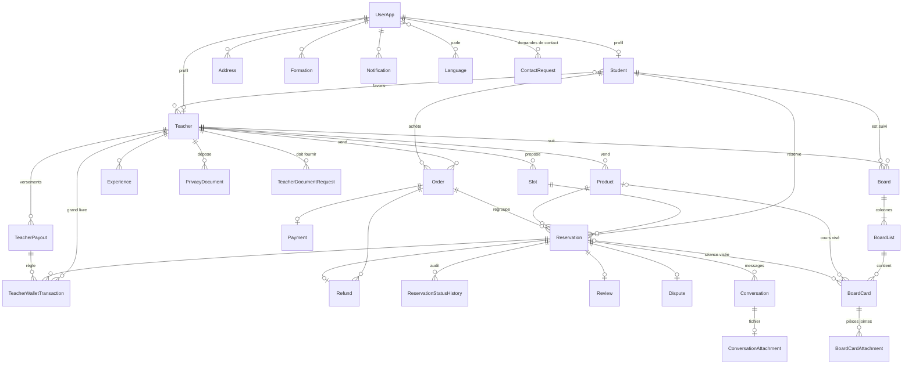

# Modèle de données

> Statut : **Stable** · Règles d'argent : [flux d'argent](../20-specs-fonctionnelles/04-flux-argent.md)
>
> Ce document décrit le **modèle cible**. Les écarts avec
> [`MainContext`](../../RestaurantHandler/Persistence/MainContext.cs) et [`Domain/Entities/`](../../RestaurantHandler/Domain/Entities/) sont listés dans la
> dernière section, [État dans le code](#état-dans-le-code).

## Conventions générales

| Convention | Règle |
|---|---|
| Clé primaire | `Guid` partout |
| Horodatage | `CreatedAt`, `UpdatedAt`, en UTC |
| Suppression | **logique** via `ArchivedAt` ; les entités concernées portent un filtre global |
| Montant | `numeric(18,2)` |
| Taux | `numeric(5,4)` |
| Date et heure | `timestamptz` |
| Libellé de référentiel | dictionnaire JSON indexé par code de langue en minuscules |

**Trois familles de base :**

- `BaseModel` — identifiant et horodatages ;
- `BaseModelOption` — plus libellé technique, couleur et icône : une valeur de référentiel
  prête à afficher ;
- `TranslatableModelOption` — plus le dictionnaire de libellés. **Toutes** les valeurs de
  référentiel en dérivent ; le libellé technique reste le repli canonique et la clé
  d'unicité.

## Vue d'ensemble

## Entités

### Identité

**`UserApp`** — le compte. Prénom, nom, date de naissance, avatar, titre, description, les
deux consentements, statut de compte, genre, identifiant du fournisseur d'identité externe.
Rattaché à ses rôles, ses adresses, ses formations, ses langues parlées, ses notifications.

> **Date de naissance et genre sont facultatifs.** Un compte créé par fournisseur externe n'en
> porte aucun : le fournisseur ne les atteste pas. L'inscription classique les exige, le profil
> permet de les compléter.

**`UserSession`** — une session ouverte : famille, échéance glissante, échéance absolue,
révocation et son motif, session qui la remplace, empreinte d'adresse. C'est elle qui rend la
déconnexion réelle et la rotation détectable. Index sur (utilisateur, révocation) et sur la
famille. Voir [sécurité](../30-specs-techniques/04-securite.md).

**`Teacher`** — profil vendeur, **clé primaire partagée** avec le compte. Réseaux sociaux,
tarif indicatif, informations professionnelles (SIRET, statut de vérification, raison
sociale, adresse, code d'activité), état bancaire (identifiant de compte chez le
prestataire, confirmation), état de vérification documentaire et sa date, note moyenne et
nombre d'avis dénormalisés.

**`Student`** — profil acheteur, clé primaire partagée. Aucun attribut propre : il existe
pour porter les relations et rendre le rôle explicite dans le modèle.

### Offre

**`Product`** — intitulé, description, prix, professeur, niveau, catégories (relation n-n).
Suppression logique.

**`Slot`** — début, fin, professeur, type. Index sur (professeur, début). Suppression
logique.

**`Formation`** — rattachée au **compte**, pas au profil professeur : un élève peut aussi
afficher un cursus.

**`Experience`** — rattachée au profil professeur. Suppression logique **filtrée**, comme la
formation dont elle partage toutes les règles.

### Transaction

**`Reservation`** — l'entité centrale.

| Champ | Rôle |
|---|---|
| Intitulé, description | saisis par l'élève |
| Créneau, produit, élève, commande | les liens |
| Statut | avec un code numérique **en ajout seul** |
| Prix unitaire, montant, taux de commission | **figés** à la réservation, jamais recalculés |
| Code de présence, nombre d'essais, verrou temporaire | preuve de réalisation |
| Échéance de réponse du professeur | uniquement en flux sans paiement |

Index sur (créneau, statut) : c'est la requête de disponibilité.

**`ReservationStatusHistory`** — journal **en ajout seul** : état d'origine (vide à la
création), état d'arrivée, auteur (vide si système), motif. Index sur (réservation, date).
Seule source d'audit d'un domaine où l'argent dépend de l'état.

**`Order`** — numéro unique, date, total, réduction, statut, élève, **professeur**
dénormalisé, échéance de paiement, identifiant de session de paiement, **numéro de
tentative avec contrôle de concurrence**, indicateur d'exigence de paiement figé à la
création.

> **Forme du numéro :** `BP-{année}-{séquence sur 6 chiffres}`, produit par une **séquence
> PostgreSQL** posée en valeur par défaut de la colonne. L'unicité ne dépend donc pas de
> l'application : deux commandes créées simultanément ne peuvent pas porter le même numéro.

**`Payment`** — relation 1:1 avec la commande. Montant, moyen, référence de transaction,
puis frais et net renseignés **après coup** par réconciliation.

**`Refund`** — une par réservation remboursée : montant, réservation, commande,
encaissement, référence chez le prestataire, motif, statut.

### Grand livre

**`TeacherWalletTransaction`** — montant **signé**, type, professeur (lien direct pour que
le solde soit une seule requête), réservation, **rattachement à un versement** — vide tant
que la ligne est dans le solde disponible.

**`TeacherPayout`** — professeur, réservation (source de la clé d'idempotence), montant net,
**dette appliquée**, date, statut, identifiant de transfert.

> Le montant d'un versement peut valoir **zéro** : la dette a tout absorbé, le règlement
> s'est fait par compensation sans appel externe.

### Confiance

**`Review`** — note de 1 à 5, commentaire, réservation avec **contrainte d'unicité**.
Suppression logique pour la modération.

**`Dispute`** — réservation avec **contrainte d'unicité**, auteur, motif obligatoire, statut,
issue, montant remboursé, arbitre, date de résolution, note de résolution, indicateur de
résolution automatique et horodatage de relance.

> **Le motif est une énumération persistée, pas un référentiel.** Il n'a ni couleur, ni icône, ni
> administration, et le contrat d'API n'expose aucun point d'accès pour le lire : la description
> OpenAPI le sérialise par son nom, ce qui suffit au client à en construire la liste. Il est
> toujours accompagné d'une précision en texte libre — aucune valeur de la liste ne se suffit à
> elle-même pour arbitrer.
>
> L'horodatage de relance est ce qui rend la relance de l'administration **idempotente** : une
> tâche rejouée ne relance pas deux fois. Voir
> [ADR-0011](../40-decisions/ADR-0011-resolution-auto-litige.md).

**`Conversation`** — un message : contenu, réservation, expéditeur. Une ligne **est** un
message : il n'y a pas d'entité de fil, la conversation est l'ensemble des lignes
rattachées à une réservation. L'ordre chronologique tient à l'horodatage serveur.

**`ConversationAttachment`** — fichier d'un message : spécialise `Document`, dans sa propre
table, avec le message en clé étrangère unique — un fichier au plus par message, dont le
contenu sert alors de légende et peut être vide. Image ou PDF, vingt au plus par réservation
([ADR-0016](../40-decisions/ADR-0016-pieces-jointes-chat.md)). Jamais supprimé : le fil est
immuable.

**`ContactRequest`** — message adressé à un professeur depuis sa fiche, avant toute
réservation : élève, professeur, objet, corps. Le corps est **persisté** parce que
l'e-mail est rendu à la livraison : le faire transiter par la file le rendrait lisible en
clair dans le tableau de bord des tâches.

**`Document`** — nom, chemin de stockage, type, taille, date, et propriétaire optionnel
parmi professeur, élève, réservation ou **commande** — ce dernier sert de garantie d'unicité
de la facture.

**`PrivacyDocument`** — spécialise le document : titre, description, type, statut de revue,
relecteur, date, **motif de refus**.

**`TeacherDocumentRequest`** — pièce attendue d'un professeur : type, demandeur (vide si
générée automatiquement), note. L'archivage vaut clôture. Index sur (professeur, archivage).

### Suivi de cours

Décision structurante : [ADR-0014](../40-decisions/ADR-0014-tableaux-de-suivi.md). Règle de
rattachement : [invariant I15](../20-specs-fonctionnelles/01-regles-metier.md#i15--un-tableau-de-suivi-relie-un-professeur-et-un-élève-qui-partagent-une-réservation).

**`Board`** — un tableau de suivi : professeur, élève, titre. Le couple (professeur, élève)
n'est **pas** unique : un professeur ouvre autant de tableaux qu'il veut pour un même élève.
Suppression logique — archiver un tableau conserve ses listes et ses cartes.

**`BoardList`** — une colonne : tableau, titre, **position**. Pas de suppression logique : une
liste se supprime physiquement, et seulement si elle ne contient plus de carte active ; ses
cartes archivées passent alors dans la première liste restante. Rien ne distingue les trois
listes créées avec le tableau des suivantes.

**`BoardCard`** — une carte : liste, titre, **importance** (énumération persistée), produit
facultatif, réservation facultative, description, **position**. La description est du HTML
**nettoyé à l'écriture** ; la colonne est plus large que `CARD_DESCRIPTION_MAX_LENGTH` pour
le balisage conservé. Suppression logique.

**`BoardCardAttachment`** — pièce jointe d'une carte : spécialise `Document`, dans sa
propre table comme `PrivacyDocument`, avec la carte en clé étrangère. Image ou PDF, dix au plus
par carte ([ADR-0015](../40-decisions/ADR-0015-pieces-jointes-cartes.md)). Suppression
**physique**, objet stocké compris ; archiver la carte ne la touche pas.

> **Les positions sont des entiers contigus à partir de 0**, par liste pour les cartes, par
> tableau pour les listes. Un déplacement réécrit les positions des listes source et cible
> dans une seule transaction ; les cartes archivées n'ont pas de position significative et
> reçoivent la dernière à leur restauration.
>
> **La carte ne porte pas de lien direct vers le tableau.** Elle l'atteint par sa liste, ce
> qui rend impossible une carte rangée dans la liste d'un autre tableau.

### Localisation

**`Address`** — rue, ville, pays, code postal, complément, **longitude et latitude**,
utilisateur, type. **Contrainte d'unicité sur (utilisateur, type)** : une seule adresse
principale et une seule de facturation.

## Référentiels

Tous en `TranslatableModelOption`, pré-alimentés avec des identifiants fixes :

| Référentiel | Valeurs | Administrable |
|---|---|---|
| Rôle | Élève · Professeur · Admin · Super-admin | non |
| Genre | Masculin · Féminin · Autre | non |
| Statut de compte | Actif · En attente · Banni | non |
| Statut de réservation | En attente · Confirmée · Refusée · Terminée · Annulée · Livrée · Versable · En litige | non |
| Statut de commande | En attente · Payée · Remboursée · Partiellement remboursée | non |
| Statut de transaction | En attente · Réglée · En échec | non |
| Type de transaction | Encaissement · Remboursement · Versement · **Pénalité** · **Récupération** | non |
| Moyen de paiement | Carte | non |
| Statut de litige | Ouvert · Résolu | non |
| Issue de litige | Professeur · Élève · Partielle | non |
| Type d'adresse | Principale · Facturation | non |
| Type de créneau | Présentiel · Visio · Indifférent | **oui** |
| Niveau | Tous · Débutant · Intermédiaire · Avancé | **oui** |
| Catégorie | ouvert | **oui** |
| Langue | Français · Anglais · Arabe | **oui** |
| Type de pièce justificative | Identité · Diplôme · Immatriculation · Justificatif de domicile · Autre | **oui** |
| Type de notification | Compte · Réservation · Paiement · Message · Produit · Document | non |

**Deux règles impératives :**

1. **Aucun identifiant pré-alimenté en double entre familles.**
2. **Les énumérations persistées sont en ajout seul.** Leur valeur numérique est stockée :
   réordonner corrompt silencieusement les données.

   Concernées : statut de réservation, type et statut de transaction, statut de commande, statut
   de revue documentaire, niveau, catégorie, type de créneau, type de notification, le
   **motif de litige** et l'**importance d'une carte** — deux énumérations, pas des
   référentiels.

## Index

| Table | Index | Motif |
|---|---|---|
| `Slot` | (professeur, début) | agenda et disponibilité |
| `Reservation` | (créneau, statut) | « ce créneau est-il libre ? » |
| `Reservation` | (élève, statut), (statut, échéance) | listes et balayages |
| `ReservationStatusHistory` | (réservation, date) | timeline d'audit |
| `Order` | numéro **unique** | recherche et facture |
| `Order` | (élève, professeur, statut) | retrouver le panier en attente |
| `Order` | (statut, échéance de paiement) | balayage des commandes expirées |
| `Order` | (élève, professeur) **unique**, limité aux commandes en attente | un seul panier vivant par couple (I1) |
| `Reservation` | (créneau) **unique**, limité aux statuts vivants | R1/R4 : un créneau ne porte qu'une réservation vivante |
| `TeacherWalletTransaction` | (professeur, rattachement, archivage) | **calcul du solde** |
| `TeacherPayout` | (professeur, statut), réservation | versements et rejeu |
| `Review` | réservation **unique** | un avis par cours |
| `Favorite` | (élève, professeur) **unique** | pas de doublon |
| `Address` | (utilisateur, type) **unique**, hors lignes archivées | une adresse par type |
| `Teacher` | SIRET **unique**, hors valeurs vides | un établissement par compte |
| `UserSession` | (utilisateur, révocation), famille | révocation en masse, détection de rejeu |
| `Dispute` | réservation, statut | files d'arbitrage |
| `Refund` | réservation, statut | balayage des remboursements |
| `TeacherDocumentRequest` | (professeur, archivage) | demandes ouvertes |
| `Address` | (longitude, latitude) | pré-filtrage géographique |
| `Conversation` | (réservation, date) | le fil, dans l'ordre |
| `ConversationAttachment` | message *(unique)* | un fichier au plus par message |
| `Notification` | (destinataire, lu) | le panneau et le compteur de non-lues |
| `ContactRequest` | (élève, professeur, date) | plafond de fréquence par couple |
| `Board` | (professeur, élève, archivage) | barre latérale du professeur, vue de l'élève |
| `BoardList` | (tableau, position) | colonnes dans l'ordre |
| `BoardCard` | (liste, archivage, position) | cartes actives dans l'ordre |
| `BoardCardAttachment` | carte | pièces jointes d'une carte, et leur nombre par carte |

## Comportements de suppression

| Relation | Comportement | Motif |
|---|---|---|
| Compte → profils, adresses, formations | cascade | données sans vie propre |
| Réservation → historique, messages | cascade | journaux attachés |
| Tout → référentiel | **restreint** | on ne détruit pas une valeur référencée |
| Réservation, commande → écritures comptables | **restreint** | l'argent survit à tout |
| Réservation → avis, litige | restreint | traces de confiance |
| Litige → arbitre | mise à vide | l'arbitrage reste lisible après la suppression du compte |
| Utilisateur → auteur d'une action d'audit | mise à vide | la trace survit à la suppression de l'auteur |
| Tableau → listes → cartes | cascade | données sans vie propre ; ne joue qu'à l'effacement d'un compte ([Q14](../50-backlog/02-questions-ouvertes.md)) |
| Liste → cartes actives | **refusé** | on ne perd pas de travail en supprimant une colonne |
| Carte → produit, réservation | restreint | l'archivage d'un produit ou d'une réservation laisse la carte et son lien intacts |

**Règle générale :** rien de ce qui porte une conséquence financière ou probatoire n'est
supprimé physiquement.

## Filtres globaux

Un filtre d'archivage est appliqué automatiquement sur les entités à suppression logique :
produit, créneau, adresse, formation, **expérience**, avis, document.

Le **tableau de suivi** et la **carte** n'en portent pas : un tableau archivé reste lisible
par son professeur, et `IgnoreQueryFilters` ferait reparaître les cartes archivées avec lui.
[`BoardService`](../../RestaurantHandler/Services/BoardService.cs) filtre `ArchivedAt` explicitement.

> **Piège connu :** ces filtres **ne s'appliquent pas** aux agrégations écrites à la main sur
> le grand livre. Toute somme de portefeuille doit exclure explicitement les lignes
> archivées. Voir
> [invariant I9](../20-specs-fonctionnelles/01-regles-metier.md#i9--toute-somme-de-portefeuille-exclut-les-lignes-archivées).

## Migrations

- Une migration par changement fonctionnel, nommée en clair.
- **Aucune migration destructrice** sans une étape de reprise de données explicite.
- L'alimentation des référentiels se fait par migration, avec des identifiants fixes, afin
  qu'un environnement neuf et un environnement existant convergent.
- Les migrations sont appliquées au démarrage en développement ; en production, c'est une
  **étape de déploiement distincte**, jamais un effet de bord du démarrage applicatif.

## État dans le code

Relevé dans [`MainContext`](../../RestaurantHandler/Persistence/MainContext.cs) (identité ASP.NET :
`IdentityDbContext<UserApp, RoleApp, Guid>`) et dans les entités.

### Entités

| Cible | Existant | Écart |
|---|---|---|
| `UserSession` | `RefreshToken` | pas de famille, de révocation ni d'échéance absolue ([ADR-0002](../40-decisions/ADR-0002-auth-cookies-httponly.md)) |
| `ContactRequest` | — | **absente** : le contact part directement en e-mail, sans trace ni plafond |
| `Order.OrderNumber` | `BP_yyyyMMdd_NNN`, calculé dans [`ReservationCartService`](../../RestaurantHandler/Services/Reservations/ReservationCartService.cs) avec rejeu sur collision de l'index unique | pas de séquence PostgreSQL |
| `Order.CheckoutAttempt` | `[ConcurrencyCheck]` | conforme |
| `Dispute` | motif en **texte libre** (`string Reason`) | pas d'énumération de motif, pas de montant remboursé, pas d'indicateur de résolution automatique ni d'horodatage de relance |
| `Dispute` | index simple sur la réservation | **pas d'unicité** : deux litiges peuvent viser la même réservation au niveau base |
| `TeacherPayout` | `ReservationId` **facultatif**, `Amount`, `DebtApplied`, `StripeTransferId` | conforme, hors caractère facultatif de la réservation |
| `Payment` | `StripeFee`, `NetAmount`, `BalanceTransactionId` renseignés après coup | conforme |
| Montants | `decimal(18,2)` déclaré par attribut sur les entités | conforme |
| Horodatages | `DateTimeOffset.UtcNow` majoritaire, `DateTimeOffset.Now` encore utilisé à 5 endroits | à uniformiser en UTC |
| `Profile` | `DbSet` commenté dans `MainContext` | à supprimer |
| `Board`, `BoardList`, `BoardCard` | — | **absentes** : suivi de cours non implémenté ([E20](../10-user-stories/E20-suivi-de-cours.md)) |

Les référentiels (`CategoryCursus`, `LevelCursus`, `TypeSlot`, `TypeAddress`, `Gender`,
`Language`, `StatusReservation`, `StatusOrder`, `StatusTransaction`,
`TypeTeacherTransaction`, `PaymentMethod`, `PrivacyDocumentType`, `DisputeStatus`,
`DisputeOutcome`, `RoleApp`) existent tous.

### Index présents

(professeur, début) sur `Slot` · (créneau, statut) sur `Reservation` · (réservation, date)
sur `ReservationStatusHistory` · numéro **unique** sur `Order` · réservation **unique** sur
`Review` · (élève, professeur) **unique** sur `Favorite` · (utilisateur, type) **unique hors
archivées** sur `Address` · (professeur, archivage) sur `TeacherDocumentRequest` ·
réservation sur `Dispute` et sur `Refund`.

**Absents** par rapport au tableau cible : (élève, statut) et (statut, échéance) sur
`Reservation` ; les index de balayage et l'unicité du panier vivant sur `Order` ; l'unicité
de la réservation vivante par créneau ; (professeur, rattachement, archivage) sur
`TeacherWalletTransaction` ; les index de `TeacherPayout`, `Conversation`, `Notification` et
de géolocalisation ; l'unicité du SIRET.

### Filtres globaux

Présents sur `Review`, `Formation`, `Address`, `Product`, `Slot`. **Absents** sur
`Experience` et `Document`.

### Suppressions

Les comportements `Cascade`, `Restrict` et `SetNull` sont déclarés relation par relation dans
`MainContext` et suivent globalement la cible. Deux points restent à vérifier : les
suppressions *physiques* de réservations faites par les tâches d'expiration (voir
[machines à états](../20-specs-fonctionnelles/02-machines-etats.md#état-dans-le-code)) et le
comportement par défaut des relations non configurées.

### Migrations

Une seule migration, `20260823115125_reset`, qui recrée tout le schéma. Les migrations sont
appliquées **au démarrage de l'application** (`context.Database.Migrate()` dans
[`Program.cs`](../../RestaurantHandler/Program.cs)), en production comme en développement, suivies de
l'alimentation des comptes par défaut.
