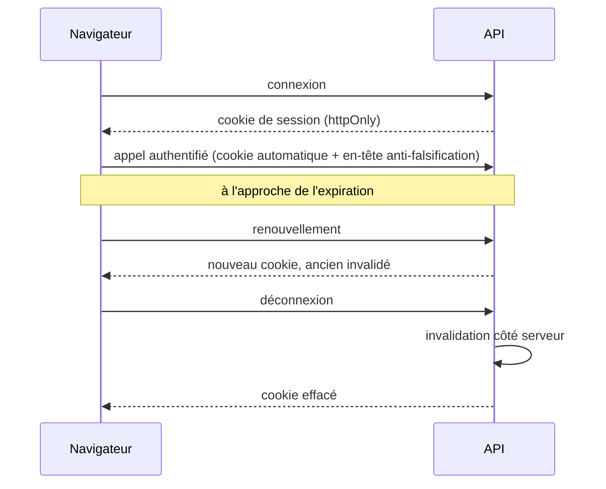

# Sécurité

> Statut : **Stable** · Décision : [ADR-0002](../40-decisions/ADR-0002-auth-cookies-httponly.md)
>
> Chaque section décrit la cible. L'état du code est rassemblé dans
> [Failles et écarts actuels](#failles-et-écarts-actuels), par gravité.

## Authentification

### Session par cookie, pas par jeton en en-tête

Aujourd'hui, l'API émet un **JWT d'accès** que le front conserve et renvoie dans l'en-tête
`Authorization`, et un **jeton de renouvellement** en cookie `httpOnly`, `Secure`,
`SameSite=Strict`. Le JWT est lisible par le script de la page : **toute faille d'injection
de script y donne accès**, et il reste valable jusqu'à son expiration, même après
déconnexion — la déconnexion actuelle efface le cookie sans invalider le jeton de
renouvellement en base.

La cible est une **session matérialisée par un cookie** :

| Attribut | Valeur | Raison |
|---|---|---|
| `HttpOnly` | oui | inaccessible au JavaScript de la page |
| `Secure` | oui | jamais transmis en clair |
| `SameSite` | `Lax` | bloque l'essentiel des requêtes inter-sites, tout en laissant passer les retours de redirection du prestataire de paiement |
| `Path` | `/` | — |
| Durée | courte, renouvelée silencieusement | limite la fenêtre d'exploitation |

**Conséquences à assumer :**

1. **Protection anti-falsification obligatoire.** Un cookie est envoyé automatiquement par
   le navigateur : sans garde, un site tiers pourrait déclencher une action authentifiée.
   Toute requête mutante porte un en-tête anti-falsification vérifié côté serveur.
2. **Origines strictement contrôlées.** La liste des origines autorisées est explicite, avec
   les identifiants de session autorisés. Aucun joker.
3. **Le rendu serveur transmet le cookie.** Si le front effectue des appels côté serveur, il
   relaie le cookie de la requête entrante.
4. **Le temps réel utilise la même session.** Pas de second mécanisme d'authentification.

### Cycle de vie

- **Le renouvellement fait tourner l'identifiant de session.** Un identifiant réutilisé après
  rotation est le signe d'un vol : la famille de sessions est alors invalidée.
- **La déconnexion invalide côté serveur.** Effacer le cookie ne suffit pas.
- **Un changement de mot de passe invalide toutes les autres sessions.**
- **Deux renouvellements concurrents ne produisent qu'un appel** côté client.

### Mots de passe et accès

| Règle | Valeur |
|---|---|
| Longueur minimale | 8 caractères |
| Complexité imposée | non — la longueur prime sur les contraintes de caractères |
| Verrouillage | 5 tentatives, 2 minutes |
| Unicité de l'adresse | oui |
| Adresse confirmée exigée | oui, sauf connexion par fournisseur externe |
| Durée de vie d'un jeton de lien | 1 heure |

Un identifiant inexistant et un mot de passe faux renvoient **le même message**. La demande
de réinitialisation répond toujours identiquement, que l'adresse existe ou non.

### Connexion externe

Le jeton d'identité du fournisseur est validé **côté serveur** — signature, émetteur,
audience, expiration. Le rattachement se fait par identifiant du fournisseur, puis par
adresse. Le contrôle de bannissement précède **toute** écriture.

## Autorisation

**Refus par défaut.** Une opération sans déclaration explicite d'autorisation est
inaccessible. C'est l'inverse du code actuel, où plusieurs opérations sensibles sont
ouvertes par omission.

Deux contrôles systématiques :

1. **Le rôle**, déclaré sur l'opération elle-même.
2. **La propriété**, vérifiée dans le service à partir de **l'identité de la session** — et
   jamais d'un identifiant fourni par le client.

Une ressource existante mais non possédée répond « introuvable », pas « interdit ».

## Fichiers

| Contrôle | Règle |
|---|---|
| Type réel | vérifié par **signature binaire**, jamais par extension ou type déclaré |
| Extensions | liste blanche explicite par usage |
| Taille | plafonnée par usage, refus explicite au-delà |
| Nom | assaini ; le nom d'origine n'est jamais un chemin |
| Visibilité | public pour les avatars, **privé** pour les pièces et factures |
| Accès privé | **lien signé à durée limitée**, jamais d'URL devinable |
| Stockage | les fichiers privés ne sont jamais servis depuis un répertoire statique |

## Entrées et sorties

- **Validation déclarative** sur chaque représentation d'entrée ; une entrée invalide est
  rejetée avec le détail par champ.
- **Texte enrichi nettoyé à l'écriture et à l'affichage** — descriptions de profil, messages,
  avis, motifs de litige, descriptions de cartes de suivi. Pour ces dernières, la liste des
  balises admises est fixée par [ADR-0014](../40-decisions/ADR-0014-tableaux-de-suivi.md) ;
  l'absence de nettoyage aujourd'hui est la dette [D-22](../50-backlog/03-dette-technique.md).
- **Aucune entité de base renvoyée telle quelle** : le risque est d'exposer par
  accident une donnée ajoutée plus tard.
- **Requêtes paramétrées uniquement.** Le moteur de filtre dynamique n'accepte que des champs
  déclarés, jamais une expression arbitraire du client.

## Limitation de débit

| Opération | Motif |
|---|---|
| Connexion, réinitialisation, inscription | attaque par force brute et énumération de comptes |
| Contact d'un professeur | pourriel |
| Ouverture d'un paiement | création de sessions en masse |
| Saisie du code de présence | déjà verrouillée après plusieurs essais, plus une limite globale |
| Téléversement | saturation du stockage |

## En-têtes et transport

HTTPS partout, transport strict, politique de sécurité de contenu, interdiction de
l'encadrement de la page, pas de reniflage de type, référent restreint. Les en-têtes
transmis par le proxy inverse ne sont acceptés que de proxies connus.

## Secrets

- **Aucun secret dans le dépôt**, y compris dans les fichiers d'exemple.
- Toute la configuration vient de variables d'environnement ; un fichier local sert au
  développement et n'est jamais versionné.
- **Aucune valeur de repli** sur un secret : son absence fait échouer le démarrage, bruyamment.
- Les clés sont distinctes par environnement et rotables sans redéploiement du code.

## Journalisation

Ne **jamais** journaliser : mot de passe, jeton, cookie, lien de réinitialisation, données de
carte, contenu de pièce justificative, corps d'e-mail rendu.

**Toujours** journaliser, avec identifiant de corrélation : authentification réussie ou
échouée, changement de rôle ou de statut de compte, décision documentaire, arbitrage de
litige, tout mouvement d'argent avec sa clé d'idempotence, toute consultation d'une
conversation par un administrateur.

## Notifications du prestataire de paiement

- **Signature vérifiée** avec un secret distinct par point de réception.
- Traitement **idempotent** : rejouer une notification n'a aucun effet.
- Réponse rapide, traitement long différé.
- Une notification concernant une session qui n'est plus la session courante est ignorée.

## Failles et écarts actuels

Relevé au 2026-09-16. Chaque ligne a son entrée dans la
[dette technique](../50-backlog/03-dette-technique.md), qui porte la correction.

### Critiques

| Faille | Où | Conséquence |
|---|---|---|
| **Corps des e-mails dans la file** (D-04 bis) | les tâches Hangfire d'e-mail portent le corps rendu, **liens de réinitialisation compris**, en clair dans `hangfire.job` | le tableau de bord est désormais réservé à l'administration, mais la base reste une source de liens valides |

### Élevées

| Faille | Où | Conséquence |
|---|---|---|
| — | — | toutes corrigées aux lots 0 et 2 |

### Corrigées au lot 0 (2026-09-16)

| Faille | Correction | Dette |
|---|---|---|
| **Transfert manuel anonyme** (`POST /Payment/connect/transfer`) | route supprimée | D-01 |
| **Onboarding et session de paiement anonymes** | rôle exigé ; professeur et commande lus dans la session | D-02, D-03 |
| **Tableau de bord Hangfire public** | monté après l'authentification, réservé à l'administration | D-04 (D-04 bis ouvert) |
| **Secrets avec valeurs de repli**, dont la clé JWT et les mots de passe d'administration | démarrage refusé si une variable manque | D-05 |
| **Comptes bannis ou non activés acceptés** | garde commune à la connexion, à Google et au renouvellement ; bannissement → jetons de renouvellement supprimés | D-06 |
| Réservation et conversation lisibles par autrui ; expéditeur pris dans la requête | participation exigée, `404` sinon ; expéditeur de la session | D-07 |
| Modification du créneau d'autrui, réaffectation par `TeacherId` | gardes de la suppression ; `TeacherId` de la requête ignoré | D-08 |
| Verrouillage inopérant, énumération de comptes, casse de l'adresse | `CheckPasswordSignInAsync` avec verrouillage, messages uniques, adresse normalisée | D-09 |
| Collision des comptes d'administration | `SUPER_ADMIN_EMAIL` distincte, vérifiée au démarrage | D-10 |
| Méthodes du hub appelables par tout client | diffusion et groupes supprimés ; chat et saisie bornés aux participants | D-11 |
| **Jeton de réinitialisation renvoyé par le mot de passe oublié** | le jeton ne part plus que par e-mail | D-33 |

### Corrigées au lot 2 (2026-09-16)

| Faille | Correction | Dette |
|---|---|---|
| Lecture des écritures et du solde de n'importe quel professeur | le professeur de la session ou l'administration ; `404` sinon | D-12 |
| Opérations sans attribut ouvertes à tous, avatar anonyme, `POST /Slots/student` anonyme | politique de repli exigeant une session ; rôle sur chaque écriture ; liste publique vérifiée par un test sur toutes les routes | D-13 |
| Suppression de formation et modification d'adresse d'autrui ; profil élève lisible par tout compte | ressource cherchée parmi celles de la session ; profil réservé à l'élève, à ses professeurs et à l'administration | D-34 |
| `403` sur une ressource d'autrui, qui en confirmait l'existence | `404` | — |

> **Action d'exploitation :** les fichiers Compose ne transmettaient pas les mots de passe
> d'administration ; les comptes d'administration déployés ont vraisemblablement les mots de
> passe de repli publiés dans le dépôt. Les changer à la main sur chaque environnement, et
> définir `SUPER_ADMIN_EMAIL` avant de déployer.

### Moyennes

| Écart | Où |
|---|---|
| Origines de développement (`localhost`, adresse du réseau local) autorisées **avec identifiants** en production ; entrées mal formées (`$"api.${…}"` produit un `$` littéral et pas de schéma) ; origine d'un ancien prestataire de paiement | [`CorsHelper`](../../RestaurantHandler/Utilities/CorsHelper.cs) |
| En-têtes transmis : `UseForwardedHeaders` sans `KnownProxies` ni `KnownNetworks`, donc seul le bouclage local est cru ; derrière un proxy en conteneur, l'adresse et le schéma d'origine sont perdus — à vérifier en production | [`Program.cs`](../../RestaurantHandler/Program.cs) |
| Déconnexion sans invalidation du jeton de renouvellement en base | `AuthController.Logout` |
| Description OpenAPI (`/swagger/v1/swagger.json`) publiée dans tous les environnements ; l'interface l'est aussi quand `ALLOW_DEMO_SEED=true` | [`Program.cs`](../../RestaurantHandler/Program.cs) |
| Aucune limitation de débit | — |
| Aucun en-tête de sécurité (HSTS, CSP, anti-encadrement) ni redirection HTTPS dans l'application | [`Program.cs`](../../RestaurantHandler/Program.cs) — peut être porté par le proxy, à confirmer |
| Plafond de requête à 200 Mo pour toute l'API | [`Program.cs`](../../RestaurantHandler/Program.cs) |

### Conforme

- Politique de mot de passe : 8 caractères minimum, sans complexité imposée ; verrouillage
  configuré à 5 essais et 2 minutes (mais voir ci-dessus).
- Validation serveur du jeton Google, et refus d'un compte banni **avant** tout rattachement.
- Vérification du type réel des fichiers par signature binaire
  ([`FileSignatures`](../../RestaurantHandler/Utilities/FileSignatures.cs), [`StorageService`](../../RestaurantHandler/Integrations/Storage/StorageService.cs)).
- Validation des jetons JWT : émetteur, audience, durée de vie et signature.
- Signature des notifications Stripe, avec un secret distinct pour les comptes connectés.
