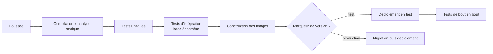

# Exploitation

> Statut : **Stable**

## Environnements

| Environnement | Rôle | Données |
|---|---|---|
| Local | développement | alimentation de démonstration, clés de test du prestataire |
| Test | validation avant mise en production | données anonymisées, clés de test |
| Production | service réel | — |

**Règles :**

- La même image est déployée en test et en production ; seule la configuration diffère.
- Les clés du prestataire de paiement sont **distinctes par environnement**, et leur nature —
  test ou réelle — est vérifiée au démarrage.
- L'alimentation de démonstration est conditionnée par un indicateur explicite, **faux par
  défaut**, et refusée en production.
- La documentation d'API interactive n'est **pas** exposée en production.

## Configuration

Toute la configuration vient de **variables d'environnement**. Un fichier local sert au
développement et n'est jamais versionné ; les variables réelles ont toujours la priorité
sur lui.

**Une variable requise manquante fait échouer le démarrage**, avec un message nommant la
variable. Aucune valeur de repli sur un secret — le code actuel en comporte pour la clé de
signature, le mot de passe de base et les mots de passe d'administration, ce qui signifie
qu'une configuration incomplète démarre silencieusement avec des secrets connus.

Un contrôle de démarrage vérifie : présence de toutes les variables requises, cohérence des
paires (les deux comptes d'administration ont des adresses **distinctes**), accessibilité de
la base, et nature des clés du prestataire.

## Base de données

- **Les migrations ne sont pas appliquées au démarrage en production.** C'est une étape de
  déploiement distincte, qui peut échouer sans laisser l'application dans un état incertain.
  En développement, l'application applique les migrations au lancement.
- Sauvegardes automatiques quotidiennes, avec rétention par jour, semaine et mois.
- **La restauration est testée périodiquement.** Une sauvegarde non restaurée n'est pas une
  sauvegarde.
- Les dumps contiennent des données personnelles : chiffrés au repos, accès restreint.

## Conteneurs

- Construction en plusieurs étapes, image d'exécution minimale, exécution **sans privilèges**.
- Version applicative injectée à la construction et exposée par un point d'accès.
- Composition locale : API, base, stockage objet, serveur d'e-mails de test.

## Stockage objet

Un seul compartiment **MinIO**, auto-hébergé sur le VPS
([ADR-0008](../40-decisions/ADR-0008-stockage-objet-unifie.md)) : les avatars (`avatars/`) sont
servis par URL publique stable, tout autre fichier par lien signé.

| Variable | Rôle | Production |
|---|---|---|
| `S3_SERVICE_URL` | point d'accès S3 **public** | `https://files.bonprof.fr` (`MINIO_SERVER_URL`) |
| `S3_REGION` | région de signature | `us-east-1` |
| `S3_ACCESS_KEY`, `S3_SECRET_KEY` | identifiants | utilisateur MinIO dédié, `readwrite` sur le seul compartiment — jamais le compte root |
| `S3_BUCKET` | compartiment unique | `bonprof`, lecture anonyme sur le **seul** préfixe `avatars/` |
| `SIGNED_URL_MINUTES` | durée des liens signés (hors avatars) | 60 par défaut |

- À poser une fois par environnement (l'utilisateur applicatif n'a pas le droit de le faire) :
  `mc anonymous set download <alias>/bonprof/avatars`. Sans cette politique, les URLs d'avatar
  renvoient `403`.

- Les liens signés sont liés à l'hôte de `S3_SERVICE_URL` : un lien signé pour `minio:9000`
  serait refusé (`403`) par le navigateur passant par `files.bonprof.fr`. L'API passe donc
  elle aussi par l'hôte public.
- Le proxy devant `files.bonprof.fr` doit transmettre l'en-tête `Host` intact, et le
  compartiment autoriser en CORS l'origine du front pour `GET`.
- Aucune reprise : les fichiers antérieurs (R2, SeaweedFS) ne sont plus référencés.

## Intégration et déploiement continus



- Aucune fusion sans compilation, analyse et tests au vert.
- Le déploiement est déclenché par un **marqueur de version**, jamais par une poussée sur une
  branche.
- La migration précède le déploiement applicatif et peut être annulée séparément.
- Les secrets viennent du coffre de la plateforme d'intégration, jamais du dépôt.

## Journalisation

- **Structurée**, avec un identifiant de corrélation propagé de la requête jusqu'aux tâches
  de fond.
- Niveaux utilisés avec discernement : information pour les événements métier, avertissement
  pour le dégradé, erreur pour ce qui exige une intervention.
- **Jamais** : mot de passe, jeton, cookie, lien de réinitialisation, données de carte,
  contenu de pièce justificative, corps d'e-mail rendu.
- **Toujours**, pour chaque mouvement d'argent : identifiant métier, clé d'idempotence,
  montant, résultat.

## Supervision

| Point | Distinction |
|---|---|
| Vivant | le processus répond |
| Prêt | la base et les dépendances critiques sont joignables |

Confondre les deux fait redémarrer en boucle une application dont seule la base est
momentanément indisponible.

**Alertes :**

| Signal | Seuil |
|---|---|
| Taux d'erreurs serveur | au-delà du bruit de fond habituel |
| Latence des parcours critiques | au-delà du budget défini |
| Tâche d'argent en échec | toute occurrence |
| Versements ou remboursements en attente | plus d'un cycle |
| Notifications du prestataire en échec | toute occurrence |
| Espace disque de la base | seuil classique |
| Certificat proche de l'expiration | 30 jours |

## Reprise après incident

| Question | Réponse |
|---|---|
| Perte de données acceptable | la dernière sauvegarde quotidienne |
| Délai de remise en service visé | quelques heures |
| Procédure | documentée et **répétée**, pas seulement écrite |

**Cas particulier des mouvements d'argent.** Après une restauration, les tâches récurrentes
rattrapent naturellement ce qui n'a pas été traité, puisqu'elles recalculent depuis la base.
Le risque est un **double versement** si une restauration ramène la base à un état antérieur
à un transfert déjà parti. La procédure impose donc, avant toute restauration, de réconcilier
les transferts réellement exécutés chez le prestataire avec les versements enregistrés.

## Conservation des données

| Donnée | Durée | Motif |
|---|---|---|
| Pièces comptables, factures | durée légale | obligation |
| Écritures de portefeuille, versements | durée légale | obligation |
| Compte supprimé | **anonymisé**, non détruit | les traces comptables survivent |
| Journaux applicatifs | quelques semaines | diagnostic |
| Pièces justificatives d'un compte fermé | purgées après la période de contestation | minimisation |
| Conversations | conservées avec la réservation | trace en cas de litige |

## Procédures locales

### Relayer les notifications Stripe

```bash
stripe listen --forward-to localhost:5113/payment/webhook
```

Le secret affiché par la commande va dans `STRIPE_WEBHOOK_SECRET`. Les notifications des
comptes connectés arrivent sur `/payment/webhook/connect`, avec leur propre secret
(`STRIPE_CONNECT_WEBHOOK_SECRET`).

### Serveur d'e-mails de test

L'envoi exige `STARTTLS` hors port 465 (`SecureSocketOptions.StartTls` dans
[`MailService`](../../RestaurantHandler/Services/MailService.cs)) : un Mailpit ou un MailHog lancé **sans
certificat** fait échouer tous les envois, de façon indirecte — cinq réessais Hangfire puis
une tâche en échec.

**Ne pas** passer à `StartTlsWhenAvailable` pour contourner : cela réintroduit une
dégradation silencieuse en clair en production. Lancer plutôt Mailpit avec un certificat
auto-signé (`MP_SMTP_TLS_CERT` / `MP_SMTP_TLS_KEY`), et faire confiance à ce certificat côté
API (`SSL_CERT_FILE=<cert.pem>`).

### Restaurer une sauvegarde

1. Supprimer l'ancienne base et en créer une vide.
2. Charger le dump :

```bash
gunzip -c <sauvegarde.sql.gz> | docker exec -i <conteneur-postgres> psql -U <utilisateur> -d <base>
```

Les dumps sont produits par le conteneur `postgres-backup-local` de la composition de
production.

## État dans le code

| Sujet | Existant | Écart |
|---|---|---|
| Environnements | production et test, chacun avec sa composition ([`docker-compose.yml`](../../RestaurantHandler/Utilities/docker-compose.yml), [`docker-compose.test.yml`](../../RestaurantHandler/Utilities/docker-compose.test.yml)) : PostgreSQL 15, pgAdmin, API, sauvegardes | pas de stockage objet ni de serveur d'e-mails dans la composition ; compositions rangées dans `Utilities/` |
| Stockage objet | MinIO derrière `StorageService`, un compartiment privé, tout par lien signé | conforme |
| Configuration | `.env` chargé par DotNetEnv, ignoré par Git ; `.env.test.example` | valeurs de repli sur les secrets ; `SMTP_*` vides dans l'exemple de test ; aucun contrôle au démarrage |
| Migrations | appliquées **au démarrage** (`Database.Migrate()`), puis création des comptes d'administration | pas d'étape de déploiement distincte |
| Image | [`Dockerfile`](../../RestaurantHandler/Dockerfile) multi-étapes .NET 8, utilisateur `$APP_UID`, `APP_VERSION` injectée | conforme |
| Intégration continue | [`docker-image.yml`](../../.github/workflows/docker-image.yml) sur étiquette `v*` ; [`docker-image-test.yml`](../../.github/workflows/docker-image-test.yml) sur `test-version-*` | **aucune compilation séparée, aucun test, aucune analyse** avant publication |
| Déploiement | SSH sur le VPS, `docker pull …:latest` (ou `:test`) puis `docker compose up -d --force-recreate` | l'étiquette de version construite n'est pas celle qui est tirée : `latest` peut désigner une autre image si deux publications se croisent ; pas de retour arrière outillé |
| Journalisation | `ILogger` et `Console.WriteLine` | ni structure ni corrélation |
| Supervision | `GET /version` | ni point de vie ni point de disponibilité, aucune alerte |
| Sauvegardes | `postgres-backup-local` en production | restauration non testée périodiquement |
