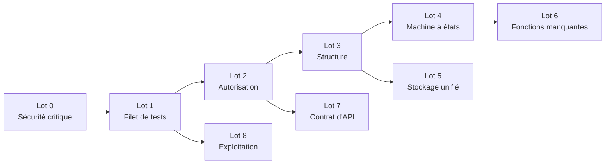

# Feuille de route du refactoring

> Statut : **Stable** — ordre de travail, pas un calendrier. BonProfAPI reste en production
> pendant tout le refactoring : chaque lot est livrable seul, sans casser le front, et
> vérifiable indépendamment.

## Principe d'ordonnancement

1. **D'abord ce qui fait perdre de l'argent ou des comptes.** Les failles critiques passent
   avant toute amélioration de structure : elles sont exploitables aujourd'hui.
2. **Ensuite le filet.** On ne déplace pas du code que rien ne vérifie. Les tests de
   caractérisation précèdent tout découpage.
3. **Puis la structure**, domaine par domaine, en commençant par le plus risqué (l'argent).
4. **Enfin le contrat et les fonctions manquantes**, qui imposent une coordination avec le
   front.

Les écarts cités renvoient à la [dette technique](03-dette-technique.md), dont les
identifiants `D-xx` sont repris ici.

---

## Lot 0 — Sécurité critique

> **Fait le 2026-09-16** (branche `fix/lot-0-securite`) : D-01 à D-11 corrigés, sauf D-04 bis
> (lot 6), ainsi que D-33, relevé en cours de lot. 48 tests d'intégration dans
> `tests/BonProf.IntegrationTests`.

**Objectif :** fermer ce qui est exploitable aujourd'hui, sans attendre les tests — chaque
correction est petite et locale.

- Supprimer le transfert manuel `POST /Payment/connect/transfer` (D-01).
- Authentifier checkout et onboarding ; désigner le professeur et la commande **par la
  session**, jamais par la requête (D-02, D-03).
- Protéger le tableau de bord Hangfire : montage après l'authentification, filtre
  administrateur (D-04).
- Supprimer les valeurs de repli des secrets ; échouer au démarrage si `JWT_KEY`,
  `DB_PASSWORD` ou les mots de passe d'administration manquent ; corriger
  `SUPER_ADMIN_EMAIL` (D-05, D-10).
- Refuser la connexion et le renouvellement d'un compte banni ou non activé ; activer le
  verrouillage (D-06, D-09).
- Contrôler la participation sur le détail de réservation, la conversation et l'envoi de
  message ; prendre l'expéditeur dans la session (D-07).
- Contrôler la propriété sur la modification de créneau (D-08).
- Rendre privées les méthodes du hub SignalR (D-11).

**Vérifiable quand :** chaque faille listée a un test d'intégration rouge avant la
correction et vert après, et un appel anonyme à une opération d'argent répond `401`.

> Le lot 0 précède le lot 1 **par exception** : ces tests-là sont écrits avec la correction,
> un par faille.

## Lot 1 — Filet de tests

**Objectif :** figer le comportement actuel avant de le déplacer.

- Projets `tests/BonProf.UnitTests` et `tests/BonProf.IntegrationTests`, PostgreSQL éphémère
  en conteneur, Stripe simulé ([stratégie de tests](../30-specs-techniques/09-strategie-tests.md)).
- Tests unitaires des briques à préserver : `CancellationPolicy`, `TeacherAvailability`,
  `ReservationStatusExtensions`, `TeacherVerificationHelper`, `MonthRange`, `Csv`,
  `SiretAttribute`, `HeoHelper`.
- Tests de contrat de l'argent : checkout, webhook de paiement, versement avec dette,
  remboursement, `charge.refunded`.
- Compilation et tests **bloquants** dans l'intégration continue, avant la construction de
  l'image (D-20).

**Vérifiable quand :** la chaîne échoue si un test échoue, et chaque invariant d'argent
([I3 à I10](../20-specs-fonctionnelles/01-regles-metier.md#2-invariants--les-règles-qui-ne-doivent-jamais-être-violées))
a au moins un test nommé.

## Lot 2 — Autorisation

> **Fait le 2026-09-16** (branche `fix/lot-2-autorisation`) : D-12, D-13 et D-34 corrigés.
> Un test parcourt toutes les routes en anonyme (`AnonymousRouteSweepTests`) ; 86 tests
> d'intégration au total.

**Objectif :** refus par défaut, autorisation déclarée sur l'opération.

- Politique de repli exigeant un utilisateur authentifié ; `[AllowAnonymous]` explicite sur
  les seules opérations publiques.
- Attributs de rôle sur tous les contrôleurs listés dans les
  [écarts de permissions](../20-specs-fonctionnelles/03-roles-permissions.md#écarts-dans-le-code-actuel).
- Contrôles de propriété manquants : portefeuille (D-12), profil élève, avatar.
- Ressource non possédée → `404`.
- Suppression de `FileController` et de `POST /Auth/dev` (D-13).

**Vérifiable quand :** un test d'intégration parcourt **toutes** les routes du
[contrat actuel](../30-specs-techniques/03-contrat-api.md#points-daccès-actuels) en anonyme
et n'obtient `200` que sur la liste publique déclarée.

## Lot 3 — Structure

> **Fait le 2026-09-17** (branche `fix/lot-3-structure`, créée depuis `fix/lot-4-machine-etats`) :
> D-15, D-17 et D-21 corrigés, plus aucun service au-delà de 800 lignes, aucun service ne reçoit
> la session HTTP. Précédé des **tests de contrat de l'argent** du lot 1 (Stripe simulé,
> `tests/BonProf.IntegrationTests/Money`) ; le reste du lot 1 (intégration continue bloquante,
> D-20) reste à faire. Document OpenAPI et modèle EF inchangés, vérifiés à chaque étape.
> 98 tests unitaires, 165 tests d'intégration.

**Objectif :** appliquer [ADR-0001](../40-decisions/ADR-0001-archi-backend.md), sans changer
le comportement.

- Les services cessent de recevoir `ClaimsPrincipal` : l'identité leur est passée.
- Découpage des quatre services de plus de 800 lignes, dans cet ordre : `PaymentService`
  (checkout / Connect / webhooks / remboursements), `ReservationService` (réservation /
  panier / annulation / présence), `OrderService` (commandes / comptabilité / bilans),
  `UserService` (profils / recherche / pièces / administration).
- Séparation des entités et des DTO ; configuration EF déplacée de `MainContext` vers des
  classes de configuration ; alimentation initiale isolée.
- Règles pures regroupées dans `Domain/Policies/` ; calcul de résolution de litige extrait en
  politique, à côté de `CancellationPolicy` (D-15), et aligné sur la spec
  ([ADR-0013](../40-decisions/ADR-0013-litige-partiel-a-charge-du-prof.md)).
- Erreurs métier en réponses typées au lieu d'`Exception` génériques ; gestionnaire global
  `ProblemDetails` ; plus de message d'exception renvoyé au client (D-17).
- Nettoyage : encodage des messages, code mort (`SendReminder`, `Profile`), dépendances
  inutilisées, chemins Windows du `.csproj` (D-21).

**Vérifiable quand :** le filet du lot 1 est vert sans modification de ses assertions, et
aucun service ne dépasse 800 lignes.

## Lot 4 — Machine à états

> **Fait le 2026-09-16** (branche `fix/lot-4-machine-etats`), **avant le lot 3** : sur la
> structure actuelle, règles dans `RestaurantHandler/Utilities/`, erreurs encore génériques. D-14, D-16,
> D-18, D-19, D-25 et une partie de D-24 corrigés ; migration `Lot4MachineEtats` avec reprise des
> réservations `DONE` non versées. Premier projet `tests/BonProf.UnitTests` (62 tests) ;
> 133 tests d'intégration au total.

**Objectif :** faire parcourir au code le graphe des
[machines à états](../20-specs-fonctionnelles/02-machines-etats.md).

- Poser `PAYABLE` à l'échéance ; le versement sélectionne `PAYABLE` au lieu d'une liste
  d'exclusion.
- Litige pro professeur ou partiel → `PAYABLE`, jamais `DONE` (D-14).
- Expirations : `CANCELLED` / `REJECTED` avec historique, plus de suppression physique ;
  purge des créneaux en suppression logique, sans toucher aux créneaux porteurs d'une
  réservation en attente (D-16).
- Définition unique de « créneau occupé », partagée par la réservation et la recherche ;
  contrôles « à venir », « pas son propre créneau », « professeur actif » (D-18).
- Avis : exiger `DONE` au lieu d'une liste d'exclusion (D-19).
- Code de présence : généré au paiement, fenêtre de saisie contrôlée, constantes nommées.
- Litige interdit en flux sans paiement ; unicité en base.

**Vérifiable quand :** un test par transition interdite échoue proprement, et une
réservation payée atteint `DONE` uniquement par `PAYABLE`.

## Lot 5 — Stockage unifié

> **Fait le 2026-09-17** (branche `fix/lot-5-stockage`, créée depuis `fix/lot-3-structure`) :
> `IStorageService` seul enregistré, sur deux compartiments (public pour les avatars, privé pour
> les pièces et factures) — sur R2, l'accès public vaut pour un compartiment entier. MinIO et le
> service R2 supprimés. **Aucune reprise** des fichiers existants : clés d'avatar héritées
> effacées (migration `Lot5StockageUnifie`), factures héritées régénérées à la demande.
> Document OpenAPI inchangé. 111 tests unitaires, 173 tests d'intégration (stockage simulé,
> `tests/BonProf.IntegrationTests/Storage`).

**Objectif :** [ADR-0008](../40-decisions/ADR-0008-stockage-objet-unifie.md).

- Une seule abstraction de stockage, `S3StorageService` comme base ; migration des usages de
  `MinioService` et `CloudflareR2Service`.
- Factures et pièces servies par lien signé.
- Reprise des fichiers existants si nécessaire.

**Vérifiable quand :** `Program.cs` n'enregistre plus qu'un service de stockage et un
fichier privé n'est jamais accessible sans lien signé.

## Lot 6 — Fonctions manquantes

**Objectif :** combler les stories `Absente` à priorité *Doit* puis *Devrait*.

- Acceptation d'un litige par le professeur (US-E11-02) ; résolution automatique et relance
  ([ADR-0011](../40-decisions/ADR-0011-resolution-auto-litige.md), US-E11-04).
- Changement de mot de passe (US-E01-07), renvoi du lien de confirmation, révocation réelle à
  la déconnexion et au bannissement.
- Prévisualisation de l'annulation côté professeur (US-E09-03).
- Plafond et persistance des demandes de contact (`ContactRequest`), contact de
  l'administration (US-E13-06, US-E17-05).
- Expériences professionnelles (US-E02-07), liste des favoris (US-E04-04).
- Nettoyage du texte enrichi à l'écriture ; e-mails rendus à la livraison, plus aucun corps
  dans la file (D-04 bis).
- Points de santé, journalisation structurée (US-E19-08).

**Vérifiable quand :** le [récapitulatif des stories](../10-user-stories/README.md#état-dimplémentation)
ne compte plus d'`Absente` en priorité *Doit*, hors [E20](../10-user-stories/E20-suivi-de-cours.md),
nouvelle fonction planifiée au [lot 9](#lot-9--suivi-de-cours).

## Lot 7 — Contrat d'API

**Objectif :** passer aux [conventions cibles](../30-specs-techniques/03-contrat-api.md#conventions-cibles).

- Renommage domaine par domaine selon la
  [migration des routes](../30-specs-techniques/03-contrat-api.md#migration-des-routes), avec
  régénération du client front **dans la même livraison**.
- Session par cookie et jeton anti-falsification
  ([ADR-0002](../40-decisions/ADR-0002-auth-cookies-httponly.md)), à coordonner avec le front.
- Concentrateur temps réel adressé par identifiant de compte, authentifié par la session.

**Vérifiable quand :** le front régénéré passe ses parcours de bout en bout contre l'API
renommée.

## Lot 8 — Exploitation

**Objectif :** [exploitation](../30-specs-techniques/08-exploitation.md) conforme.

- Migrations en étape de déploiement distincte.
- Déploiement de l'étiquette construite, pas de `latest` ; retour arrière outillé.
- Contrôle de configuration au démarrage.
- Liste CORS par environnement.
- Restauration de sauvegarde testée.

**Vérifiable quand :** une restauration est réalisée en conditions réelles et un déploiement
peut être annulé en une commande.

## Lot 9 — Suivi de cours

**Objectif :** livrer les tableaux de suivi ([E20](../10-user-stories/E20-suivi-de-cours.md)),
première fonction **nouvelle** après la v1. Il démarre une fois le lot 7 livré, pour naître
directement sous les routes cibles.

> **Fait le 2026-10-01** (branche `feat/lot-9-suivi`), **avant le lot 7** : les routes
> `/boards` et `/teachers/me/students` naissent tout de même sous leur forme cible, à côté
> des contrôleurs hérités ; enveloppe et pagination étaient déjà conformes. Du lot 6, seule
> la bibliothèque de nettoyage est tirée ; D-22 reste ouverte pour les autres champs.
> 29 tests d'intégration (`tests/BonProf.IntegrationTests/Boards`), 18 tests unitaires du
> nettoyage.

- Entités `Board`, `BoardList`, `BoardCard` et leur migration
  ([modèle de données](../30-specs-techniques/02-modele-donnees.md#suivi-de-cours)).
- Bibliothèque de nettoyage HTML et sa liste blanche
  ([ADR-0014](../40-decisions/ADR-0014-tableaux-de-suivi.md)) ; elle sert ensuite à fermer
  D-22 sur les autres champs.
- Point d'accès « mes élèves » (US-E20-01), puis tableaux, listes et cartes (US-E20-02 à
  US-E20-09), déplacement atomique compris.
- Lecture par l'élève (US-E20-11), filtres (US-E20-10).
- Tests d'intégration de propriété : tableau, liste, carte d'un autre professeur → `404` ;
  écriture par l'élève refusée ; produit étranger et réservation hors couple refusés ;
  déplacements concurrents sans doublon de position.

**Vérifiable quand :** les stories E20 *Doit* sont `Implémentée` et le front régénéré affiche
un tableau complet.

## Lot 10 — Pièces jointes du suivi

**Objectif :** permettre au professeur de joindre des images et des PDF aux cartes de suivi
(US-E20-12, US-E20-13), selon l'[ADR-0015](../40-decisions/ADR-0015-pieces-jointes-cartes.md).
Il suit le lot 9, dont il étend les entités et le service.

> **Fait le 2026-10-03** (branche `feat/lot-10-pieces-jointes`). 10 tests d'intégration
> (`tests/BonProf.IntegrationTests/Boards/BoardAttachmentTests.cs`). La suppression répond
> `200` et non `204` ; une carte archivée garde ses pièces jointes en lecture seule.

- Entité `BoardCardAttachment : Document` et migration `Lot10PiecesJointesCartes`
  ([modèle de données](../30-specs-techniques/02-modele-donnees.md#suivi-de-cours)).
- Constantes `HardCode` : extensions admises, `ATTACHMENT_MAX_SIZE_BYTES`,
  `CARD_ATTACHMENT_MAX_PER_CARD`.
- `BoardService` : ajout sous verrou du tableau (plafond par carte), dépôt par
  `StorageService.Upload` sous `boards/{boardId}/cards/{cardId}`, suppression de la ligne
  puis de l'objet ; liste des pièces jointes avec lien signé dans `BoardCardDetails`,
  `attachmentCount` dans `BoardCardTile`.
- `BoardsController` : `POST …/attachments` en `multipart/form-data`, `DELETE
  …/attachments/{attachmentId}` ([contrat](../30-specs-techniques/03-contrat-api.md#suivi-de-cours--boards)).
- Tests d'intégration, sur le modèle de `Boards/BoardContentTests.cs` et
  `Storage/StorageTests.cs` : ajout d'une image et d'un PDF ; type, signature, taille et
  onzième fichier refusés ; ajout et suppression par l'élève refusés ; carte d'un autre
  tableau → `404` ; tableau archivé → `409` ; lien signé seulement, objet supprimé avec la
  ligne ; l'élève ne voit pas les pièces jointes d'une carte archivée.

**Vérifiable quand :** US-E20-12 et US-E20-13 sont `Implémentée` et le front régénéré expose
`attachments` sur `BoardCardDetails`.

## Lot 11 — Fichiers dans le chat

**Objectif :** permettre aux deux parties d'une réservation d'échanger des images et des PDF
dans la conversation (US-E13-07), selon l'[ADR-0016](../40-decisions/ADR-0016-pieces-jointes-chat.md).
Il réutilise la chaîne de dépôt du lot 10.

> **Fait le 2026-10-03** (branche `feat/lot-11-pieces-jointes-chat`). 9 tests d'intégration
> (`tests/BonProf.IntegrationTests/Conversations/ConversationAttachmentTests.cs`).

- Entité `ConversationAttachment : Document` et migration `Lot11PiecesJointesChat`
  ([modèle de données](../30-specs-techniques/02-modele-donnees.md)).
- `AttachmentRules` extrait de `BoardService` ; constantes `HardCode` communes
  (`ATTACHMENT_EXTENSIONS`, `ATTACHMENT_MAX_SIZE_BYTES`) et
  `CHAT_ATTACHMENT_MAX_PER_RESERVATION`.
- `ConversationService.SendAttachmentAsync` : participation, contrôle, plafond sous verrou de la
  réservation, dépôt sous `reservations/{reservationId}/chat`, événement `Chat` aux deux
  parties ; `ConversationDetails.attachment` avec lien signé à la lecture.
- `SlotsController` : `POST /Slots/conversation/{reservationId}/attachments`
  ([contrat](../30-specs-techniques/03-contrat-api.md)).
- Tests : envoi par l'élève et le professeur, légende facultative, lien signé à la relecture ;
  tiers et réservation inconnue → `404` ; type, signature, taille, fichier vide, légende trop
  longue et vingt-et-unième fichier refusés sans rien stocker.

**Vérifiable quand :** US-E13-07 est `Implémentée` et le front régénéré expose `attachment` sur
`ConversationDetails`.

---

## Ce qui est reporté après la v1

- Visioconférence intégrée.
- Suivi pédagogique au-delà des tableaux du [lot 9](#lot-9--suivi-de-cours) et de leurs pièces
  jointes ([lot 10](#lot-10--pièces-jointes-du-suivi)) : progression mesurée, devoirs rendus par
  l'élève.
- Abonnements et forfaits.
- Seconde langue.
- Application mobile.
- Cache distribué et montée en charge multi-instances au-delà du temps réel.
- Montée de version .NET : indépendante du refactoring, à faire hors d'un lot fonctionnel.
